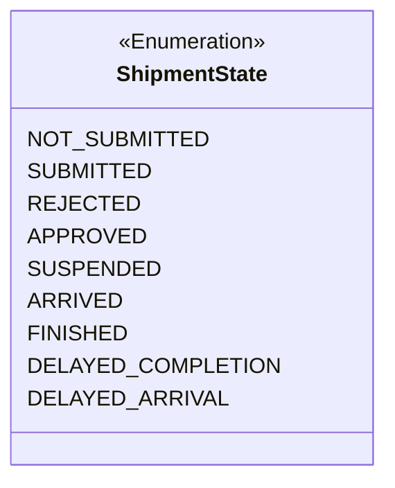

## Model shape

The shape is one enumeration, `ShipmentState`, with nine members. The ordinals in one project are NOT_SUBMITTED 1, SUBMITTED 2, REJECTED 3, APPROVED 4, SUSPENDED 5, ARRIVED 6, FINISHED 7, DELAYED_COMPLETION 8 and DELAYED_ARRIVAL 9. Ordinals are unique within the enumeration and are persisted, so existing members are never renumbered; a new member takes a new ordinal.

A reservation entity carries one required attribute of type `ShipmentState`. The entity is not part of this shape. In one project the main path is NOT_SUBMITTED, SUBMITTED, APPROVED or REJECTED, ARRIVED, FINISHED. Either party can set SUSPENDED, and who did it is recorded on the reservation as relations to the user, not in the enumeration. DELAYED_ARRIVAL and DELAYED_COMPLETION record schedule deviations.

Several actor roles take part in different stages in one project: an administrator, a requesting party, an approving party, a dispatcher, an arrival checker and a read-only role. The enumeration itself does not restrict which actor may move a reservation to which state; that is project logic on the reservation (access rules or operations), not a platform feature of the enumeration.

## Structure diagram

<!-- mermaid:generated fragment=shipment-state-enum cli=1.1.0.20261108_202643_d9769d90_develop -->

<!-- /mermaid:generated -->
