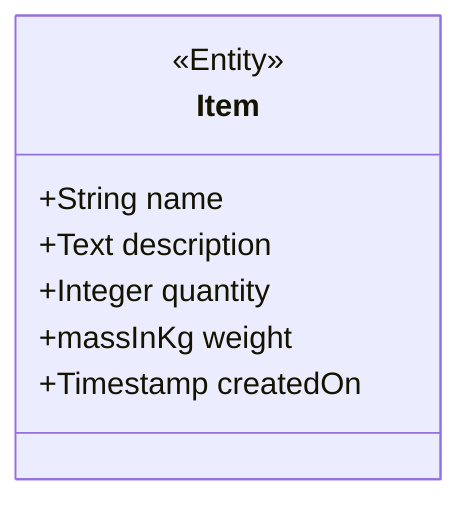

## Model shape

The shared library is two packages inside the model root, `types` and `measures`. Domain entities live elsewhere and only use them. In some projects the library is a stand-alone model imported by application models; in others it is embedded next to the entities. The definitions are near-identical across projects.

### Types package

Every attribute gets its type from here, never from an ad-hoc inline definition. The platform defines string, numeric, boolean, date, timestamp, time, binary and enumeration primitives ([type reference](../../agent-docs/model/esm_metamodel/type.md#primitive-types)). The library fixes the project-wide parameters:

- **Strings**: `String` (maxLength 255), `Text` (a longer limit, 250, 1000, 2000 or 4000 depending on the project), `Phone` (20), `URL` (1024), `Email` (255, with a pattern in some projects). The platform requires `maxLength` on every string type ([StringType rules](../../agent-docs/model/esm_metamodel/type.md#stringtype-attribute-rules)).
- **Numerics**: `Integer` (precision 9, scale 0), `Long` (18, 0), `Double` (15, 4), `Float` (7, 4). Precision is the total digit count and scale the digits after the point ([NumericType rules](../../agent-docs/model/esm_metamodel/type.md#numerictype-attribute-rules)).
- **Others**: `Boolean`, `Date`, `Timestamp`, and in some projects `Time`.
- Some projects add domain string types (network addresses, code formats). Those are project additions, not part of the library.

### Measures package

About 28 measures (Mass, Length, Time, Temperature, Area, Volume, Velocity, Force, Power, Pressure, electrical measures and so on) with about 79 units. Each measure holds units; each unit has a symbol and conversion rates (`rateDividend` / `rateDivisor`) relative to the measure's base unit ([measure package](../../agent-docs/model/esm_metamodel/other.md#measure-package)). A measure has one base unit, and derived measures (area, velocity) are built from other measures ([Measures](../../agent-docs/model/model-validation-and-transformation.md#measures)).

### Measured types

A measured type is a numeric type tied to one stored unit, for example a mass type stored in kilograms. An attribute of that type stores the value in the stored unit. A transfer object may expose the value in another unit of the same measure, and the generated DAO converts between the two. The library defines the measures; an application defines the measured types it needs. The diagram shows an entity with such an attribute next to plain string, numeric and timestamp attributes.

### Generated UI

The library adds no pages. Entities that use its types get the usual generated View, Form and Table pages; the type decides the widget options: text widgets for strings, numeric formatting and bounds for numerics, and so on ([type-to-widget mapping](../../agent-docs/model/esm_metamodel/type.md#type-to-ui-widget-mapping)).

## Structure diagram

