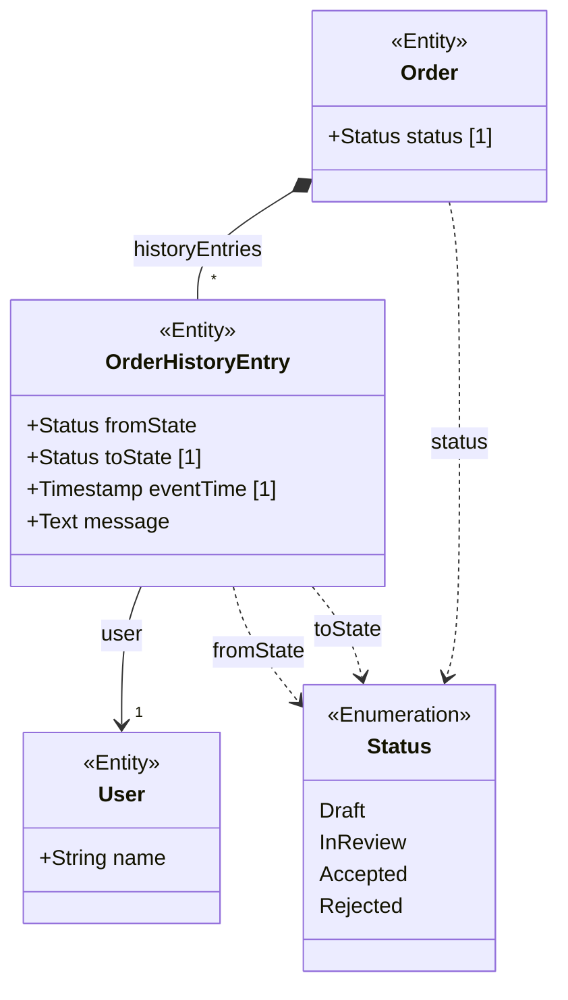

## Model shape

`Order` (the neutral name for the stateful parent) has a required `status` attribute of an enumeration with four members. It composes `OrderHistoryEntry` rows through `historyEntries`, a 0..* composition relation, so the entries are deleted with the order and created only through it.

`OrderHistoryEntry` has its create, update and delete flags off. Its attributes are `fromState` (the same enumeration, optional), `toState` (required), `eventTime` (timestamp, required) and `message` (text, optional). Its `user` relation is an association to the `User` entity with cardinality exactly one.

Transfer objects and access: the parent's transfer object exposes the entries as a read-only aggregation list. The entry transfer object adds `userRepresentation`, a derived string for the user's name. The state-changing operations of the parent are custom operations that create the entry. They are not part of this shape.

UI: the generated Table of entries on the parent's View page stays read-only. No create, edit or delete action appears, because the entry's flags are off. Sort the table by `eventTime` descending so the latest change shows first.

## Structure diagram

<!-- mermaid:generated fragment=state-transition-history-entry cli=1.1.0.20261108_202643_d9769d90_develop -->

<!-- /mermaid:generated -->
