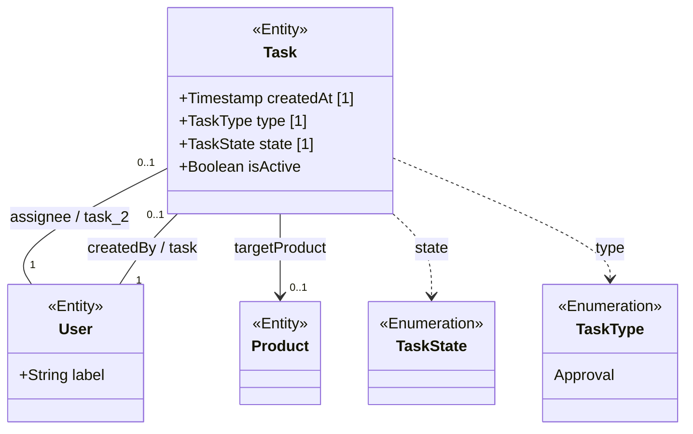

## Model shape

The Task entity sits in one package with its two enumerations, the User entity that owns the assignee link, and a Product target entity. Each task links to its creator and its assignee (both required, both to User), and to an optional target. The type and state are enumerations, so the set of allowed values is fixed in the model. The active flag defaults to false and is changed by operations, not by the creator.

Transfer objects and UI: the example exposes the entity through role-specific transfer objects (author, approver, administrator). Each maps the task's attributes, shows the target as an aggregation, and carries only the operations that role may call, such as the close operation. A small unmapped input transfer object carries the chosen result into the close operation. Generated pages: keep the Table and View of the role views, hide the generated create and delete actions (tasks are created by a domain operation), and customize the close form. Closing is a custom operation, so access checks go inside it ([interceptors](../../agent-docs/backend/interceptors.md#which-operations-are-intercepted)).

## Structure diagram

