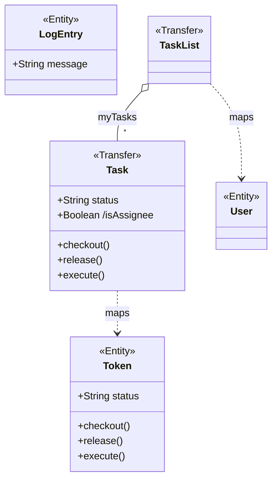

## Model shape

The shape has two views over the same records. The Token entity holds one workflow position with its assignee and status. The Task transfer object maps to Token and shows it as a work item with guard flags and the checkout, release and execute operations, each bound to the Token operation of the same name. The User entity holds the people who can claim work. The TaskList transfer object maps to User and exposes the counts and the user's own tasks. A LogEntry entity records each completed step.

## Structure diagram

<!-- mermaid:generated fragment=task-list-with-checkout-release cli=1.1.0.20261108_202643_d9769d90_develop -->

<!-- /mermaid:generated -->
