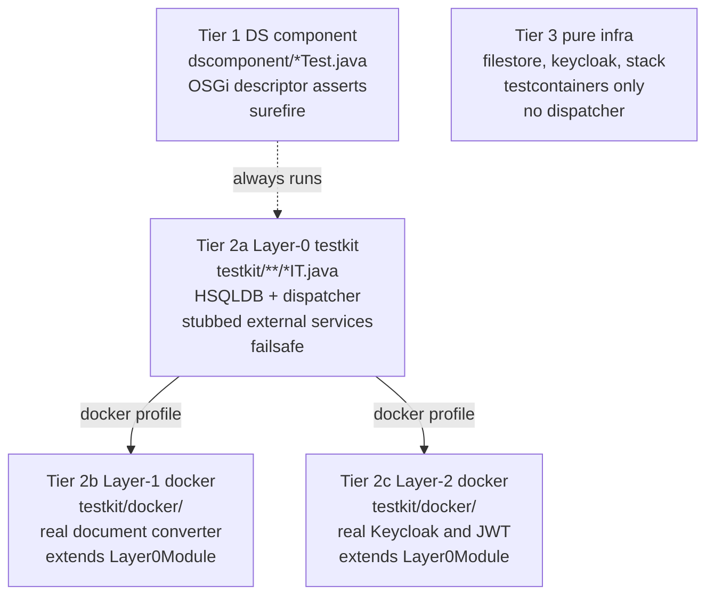

## Intent

Test a JUDO application through the real dispatcher in seconds, without OSGi, Karaf or containers. The foundation builds on the guice testkit (`judo-runtime-core-guice-testkit`) and HSQLDB. The tests exercise the access manager, the actor resolver, JQL filters, custom operation exchange functions and interceptors, and cover the whole actor surface: access links, custom operations and derived attributes. An optional docker tier swaps single external services for real images (a document converter, Keycloak with real JWTs) on the same base module.

This is infrastructure, not a model shape: there is no fragment. The platform side (fixture, `@JudoTest`, interceptor registration, access and derived tests) is described in the [integration testing docs](../../agent-docs/integration-testing/README.md). This blueprint is project practice on top of that: the support classes, the Maven layout, the flag protocol and the coverage grids.

### Tier model

| Tier | Naming | Plugin | Default | `-Pdocker` |
|---|---|---|---|---|
| 1 DS component | `*Test.java` | surefire | runs | runs |
| 2a Layer-0 testkit | `*IT.java` (no tag) | failsafe | runs | excluded |
| 2b/2c Docker overlays | `*IT.java` + `@Tag("docker")` under `testkit/docker/` | failsafe | excluded | runs |
| 3 Pure infra | `*IT.java` + `@Tag("docker")` outside `testkit/` | failsafe | excluded | runs |

## Structure

The shape is a test module, not a model. It sits next to the generated application modules.

- **Module layout**: one integration-test module with the Maven wiring, a `dscomponent/` package (tier 1), a `testkit/` package (tier 2) with a `support/` package of eight reusable classes, `access/`, `operations/` and `derived/` IT packages and a `docker/` package, plus `filestore/`, `keycloak/` and `stack/` packages for tier 3. Details in [model.md](model.md).
- **Eight support classes**: `TestContext`, `Roles`, `Seed`, `Calls`, `AuditAssertions`, `FieldInjector`, `Layer0Module`, `SdkFunctionRegistry`. Two are paste-verbatim, the others are templates with project-specific parts. Details in [backend.md](backend.md).
- **Four activation flags** on the Layer-0 module, switched on in each IT class before the runtime is built.
- **Three coverage grids**: access-link role by ownership, custom-operation smoke, audit-window assertion.

## Constraints

- **`@JudoTest` must be on the test class itself.** The extension reads the annotation without walking meta-annotations; a custom composed annotation silently leaves the fixture parameter null.
- **Flags must be set in `@BeforeAll`**, before the extension builds the injector; a static initializer on the module class is too late.
- **Do not subclass-override `@Provides` methods** in the docker modules. Guice registers both parent and child bindings for the key and fails with a duplicate binding. Use a static flag on the Layer-0 module.
- **Keep both docker exclusions**: the `docker` tag and the `testkit/docker` path.
- **Failsafe must run the verify goal** in the module, or failing ITs never fail the build.
- The reflection helpers are fragile against testkit upgrades; pin the runtime version.
- Reading the platform: the testkit's own registration of interceptors (`@JudoTest(interceptors = ...)`, `addInterceptor`) and its injection by type are documented in the [interceptor testing guide](../../agent-docs/integration-testing/interceptor-testing.md). The Layer-0 flag protocol below is the project's workaround for registering production interceptors, functions and actor resolution; prefer the documented route when it covers your case.

## Variations

- **No docker tier**: drop the docker overlay modules and the profile.
- **Real database dialect**: the platform docs describe selecting a dialect and a container for the testkit ([runtime fixture and test scope](../../agent-docs/integration-testing/runtime-fixture-and-test-scope.md)); this blueprint fixes HSQLDB for speed.
- **Shared injector** (`shareInjector`, class or singleton scope) for large suites; siblings then see each other's runtime mutations.

## When to use

- A JUDO application with actors, access links, custom operations and derived attributes whose dispatcher behaviour must be tested quickly.
- A team that needs a repeatable per-IT shape and a reusable helper set.

## When to avoid

- A handful of DAO-level tests. The documented fixture alone is enough.
- Behaviour that depends on real OSGi wiring (DS bindings the testkit cannot reproduce). Cover that with descriptor tests (tier 1) or a Karaf-runtime IT.
- Pure unit tests with mocked DAOs, when dispatcher, JQL and access behaviour is not under test.

### Costs

The foundation is about 600 lines of support code before the first IT. Some operations need a larger `Seed` before they can be called. The docker tier needs an explicit profile switch that CI must remember to set.

## Related

- [[integration-test-reflection-injection]] — narrower precursor; this blueprint subsumes it
- [[test-data-builder-factory]] — narrower precursor for the `Seed` half
- [[actor-resolution-variable-resolver]] — production side of what the actor resolution flag exercises
- [[audit-event-trail]] — production side of what `AuditAssertions` covers
- [[custom-operation-osgi-component]] — production wiring that `SdkFunctionRegistry` reproduces
- [[derived-relation-membership-invariant]] — write-side rule that pairs with the access matrix read-side rule
