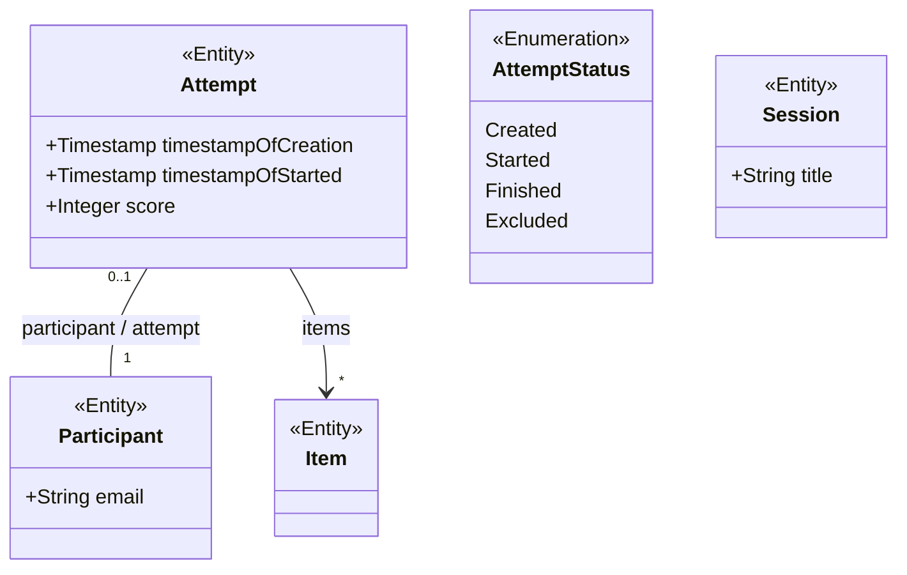

## Model shape

The Attempt entity belongs to one Participant and one Session, and it owns a list of Item entities. Its status is an AttemptStatus enumeration with five values, and it starts in Created. The three timestamps are stored separately, so the duration of the timed part can be computed exactly from the start and finish times.

## Structure diagram

<!-- mermaid:generated fragment=timed-attempt-lifecycle-entity cli=1.1.0.20261108_202643_d9769d90_develop -->

<!-- /mermaid:generated -->
