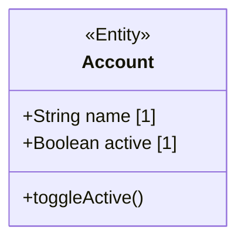

## Model shape

One entity holds the flag and the operation that flips it.

- **Account** (neutral name) has a required, stored boolean `active` with default true, plus its own attributes (here a required name).
- **toggleActive** is an instance operation on the entity with no input and no output. It is declared `customImplementation` and stateful, so the body is Java in the backend ([backend.md](backend.md)). The model does not say what it flips.

Generated UI pages follow from the entity: View, Table and Form pages as usual. The operation appears as an action on the View and Table pages. Keep it there, and hide the generated edit control for `active` if the flag should change only through the operation. Where project naming differs (`isActive` with `activateToggle` on a transfer object), the same applies to the transfer object pages.

Platform note: the operation never passes through interceptors, so no model-level guard protects it. See [Interceptors](../../agent-docs/backend/interceptors.md#which-operations-are-intercepted).

## Structure diagram

