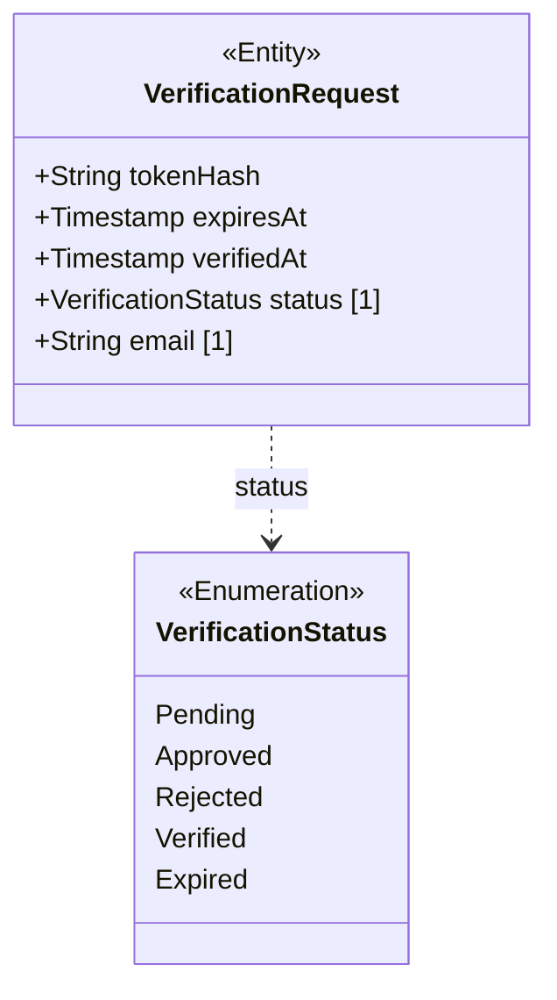

## Model shape

The VerificationRequest entity holds the token hash, the expiry and verified-at timestamps, the email the token was sent to, and a required status. The status is a VerificationStatus enumeration with five values, and it starts in Pending. The plain token is never a stored attribute.

Generated UI pages: the request is created and decided by custom operations, so keep the generated View and Table pages for reviewers and hide or disable the generated create and edit controls. The registration and verification pages are hand-written, see [frontend.md](frontend.md).

## Structure diagram

