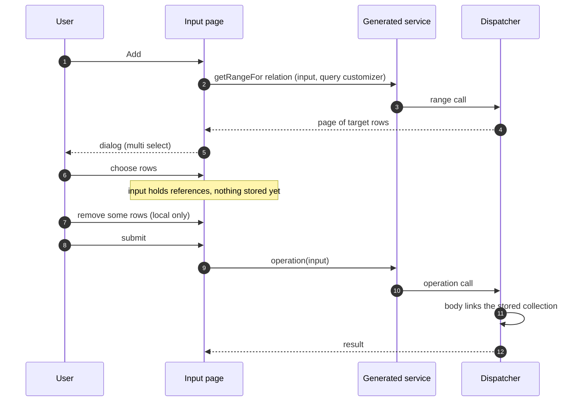

## Frontend guidance

### What the generator gives you

The generated operation input page renders the transient collection relation as a relation table with add and remove actions; adding opens a range dialog fed by the generated `getRangeFor<Relation>` operation ([UI model to frontend mapping](../../agent-docs/frontend/model-screen-layout.md), embedded table actions; [platform behavior reference](../../agent-docs/backend/platform-behavior-reference.md), range and choice operations). Remove on a transient relation only edits the local selection. It does not delete the underlying entity. For the add, remove and clear page of a stored collection see [[many-aggregation-crud-pattern]].

### Project practice: a custom embedded table

The source project (Alba) customized the field into an embedded table whose Add opens a multi-select range dialog. The components below are example project code, not platform API; the sketch shows the shape only.

```tsx
<EmbeddedTable
  label="Approvers"
  columns={userColumns}
  rows={data.users ?? []}
  readonly={!editMode}
  onAdd={async () => {
    const res = await openRangeDialog({
      columns: userColumns,
      rangeCall: (queryCustomizer) =>
        viewAssignApprovalServiceImpl.getRangeForUsers(data, queryCustomizer),
      single: false,
    });
    if (res && res.length) {
      const existing = data.users ?? [];
      const merged = [...existing, ...res.filter(r =>
        !existing.some(e => e.__signedIdentifier === r.__signedIdentifier)
      )];
      setData({ ...data, users: merged });
    }
  }}
  onRemoveRow={(row) =>
    setData({
      ...data,
      users: (data.users ?? []).filter(u => u.__signedIdentifier !== row.__signedIdentifier),
    })
  }
/>
```

- The range call is the generated one. The first argument is the current input, the second the paging and filter state.
- A multi-select dialog returns an array of rows, or nothing on cancel.
- Add appends and de-duplicates by `__signedIdentifier` (a reserved payload key, see the platform behavior reference), so re-selecting a row does not duplicate it.
- Remove filters the local collection only.
- On submit the collection is sent as the operation input and the body links it.

### Unmapped target

If the relation target is unmapped, the source projects saw a nested input form (one sub-form per element), not a picker (*verify*).

### Runtime sequence



### Examples

- Alba: `ApprovalTaskInput.users` as an embedded table on the assign-approval page; the range limited candidates to eligible users.
- actiongroup-test-react: `CreatureTemplate.signs` as an embedded list on the create-creature page; zero or more signs.
