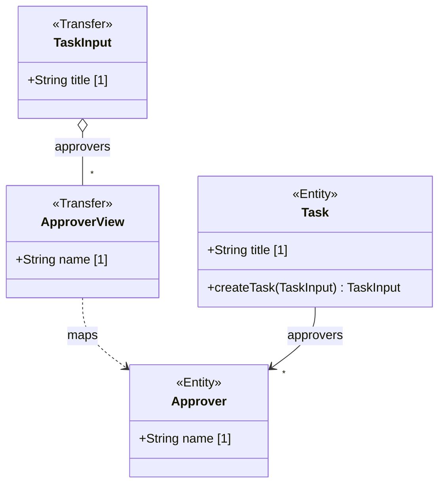

## Model shape

An operation input transfer object (unmapped) carries a transient collection relation to a mapped transfer object. The operation creates an owning entity and links the chosen records through a stored collection relation.

### Elements

- **Entity to choose from** (for example `Approver`) and its mapped transfer object (`ApproverView`), the picker's target.
- **Owning entity** (for example `Task`): a stored 0..* association to the chosen entity.
- **Input transfer object** (`TaskInput`): unmapped; transient attributes for the other inputs; one transient relation to `ApproverView`, cardinality 0..* or 1..*, kind aggregation (set by the modeling tool; a validator rule requires aggregation on unmapped transfer objects), range type any or derived.
- **Operation** with `TaskInput` as input, shown as an operation on the owning entity.

### What the generator derives

- A `getRangeFor<relation>` operation for the picker ([platform behavior reference](../../agent-docs/backend/platform-behavior-reference.md), range and choice operations).
- On the generated operation input page, the transient collection relation appears as a relation table with add and remove actions ([UI model to frontend mapping](../../agent-docs/frontend/model-screen-layout.md), embedded table actions).

### Range

A derived range expression narrows the candidates. One project limited the approver picker to active users with an approver role. Another used the plain range over all signs. See [[range-expression-filtering]].

### Unmapped target: a different shape

If the relation target is unmapped, the source projects saw nested input sub-forms instead of a picker (*verify*). That shape is not covered by this blueprint.

## Structure diagram

