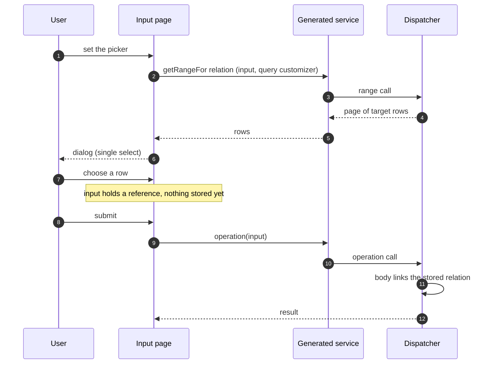

## Frontend guidance

### What the generator gives you

The generated operation input page renders the transient single relation like any single relation: an autocomplete-style selector with view, set and unset actions, whose options come from the generated range operation ([UI model to frontend mapping](../../agent-docs/frontend/model-screen-layout.md), single relation; [platform behavior reference](../../agent-docs/backend/platform-behavior-reference.md), range and choice operations). In most projects nothing needs customizing.

### Project practice: a custom picker widget

The source project used a custom `AggregationInput` widget that shows the current selection, opens a range dialog in single-select mode and writes the chosen row back into the form state. The widget and the dialog helper are example project code, not platform API. The sketch shows the shape only; see [[aggregation-input-widget]] for the widget itself and [[action-group-input-output-routing]] for how the operation input page is routed.

```tsx
<AggregationInput
  label="Region"
  labelList={[data.region?.name ?? '']}
  value={data.region}
  readonly={!editMode}
  onSet={async () => {
    const res = await openRangeDialog({
      columns,
      rangeCall: (queryCustomizer) =>
        viewCreateInitiativeServiceImpl.getRangeForRegion(data, queryCustomizer),
      single: true,
    });
    if (res) setData({ ...data, region: res });
  }}
  onRemove={() => setData({ ...data, region: null })}
/>
```

- The service call is the generated `getRangeFor<Relation>`. Its first argument carries the current input (so a range expression can read other input fields), the second the paging and filter state. Keep calling it so server-side paging, filtering and range checks still apply.
- A single-select dialog returns one row, or nothing on cancel.
- The chosen row is written into the form state; nothing is stored until the operation is submitted.

### Runtime sequence



### Example

On a create page, the picker was a single `AggregationInput` and showed the paginated, optionally range-filtered target rows in a dialog; submitting created the owning entity with the chosen row.
