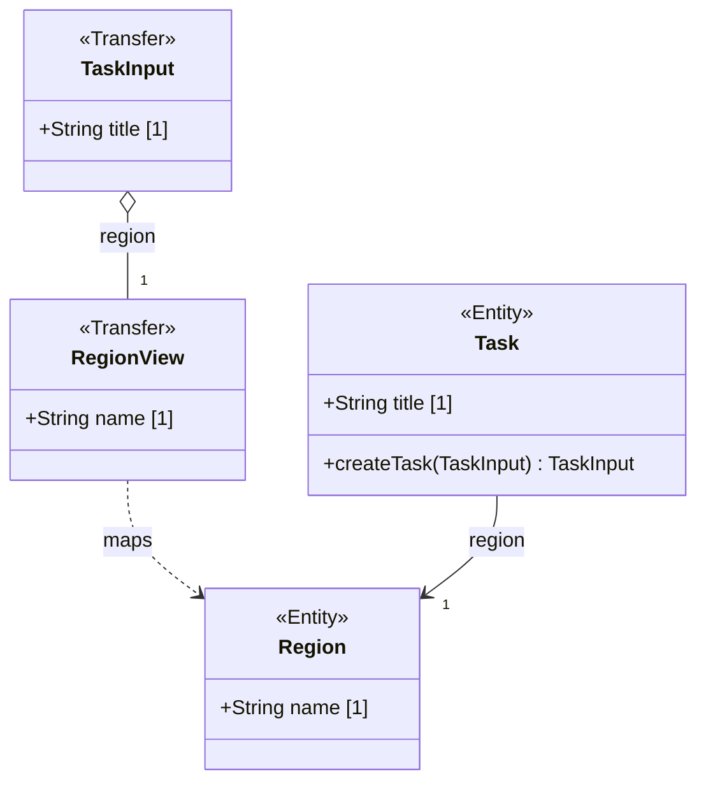

## Model shape

An operation input transfer object (unmapped) carries a transient relation to a mapped transfer object. The mapped transfer object maps an entity. The operation creates an owning entity and links the chosen record through a stored relation.

### Elements

- **Entity to choose from** (for example `Region`): a name attribute and whatever else the entity needs. Its mapped transfer object (`RegionView`) is the picker's target.
- **Owning entity** (for example `Task`): has a stored association to the chosen entity, cardinality matching the input (1 for required, 0..1 for optional).
- **Input transfer object** (`TaskInput`): unmapped; transient attributes for the other inputs; one transient relation to `RegionView` with cardinality 1..1 or 0..1, kind aggregation (the modeling tool sets it, a validator rule requires aggregation on unmapped transfer objects), range type any or a derived range expression, optional default expression.
- **Operation** with `TaskInput` as input; shown in the diagram as an operation on the owning entity.

### What the generator derives

- A `getRangeFor<relation>` operation for the picker, with the input described in the [platform behavior reference](../../agent-docs/backend/platform-behavior-reference.md) (range and choice operations).
- A form field for the relation in the generated operation input page, with view/set/unset actions as for any single relation ([UI model to frontend mapping](../../agent-docs/frontend/model-screen-layout.md)).

### Range and default

Declare the range type on the relation. A derived range expression narrows candidates, for example active records only; a default expression preselects one. Neither is validated against eligibility rules enforced elsewhere, so keep them consistent. See [[range-expression-filtering]].

### Observed alternatives (source project)

The source project declared the relation 1..1 with a default expression selecting any target instance and a second picker of the same shape on the same input. Whether the generator also needs explicit range and refresh behaviors on the relation was not settled in the source: it stated them explicitly in one project and left them out in another. Declare the range explicitly and *verify* on your generator version.

## Structure diagram

