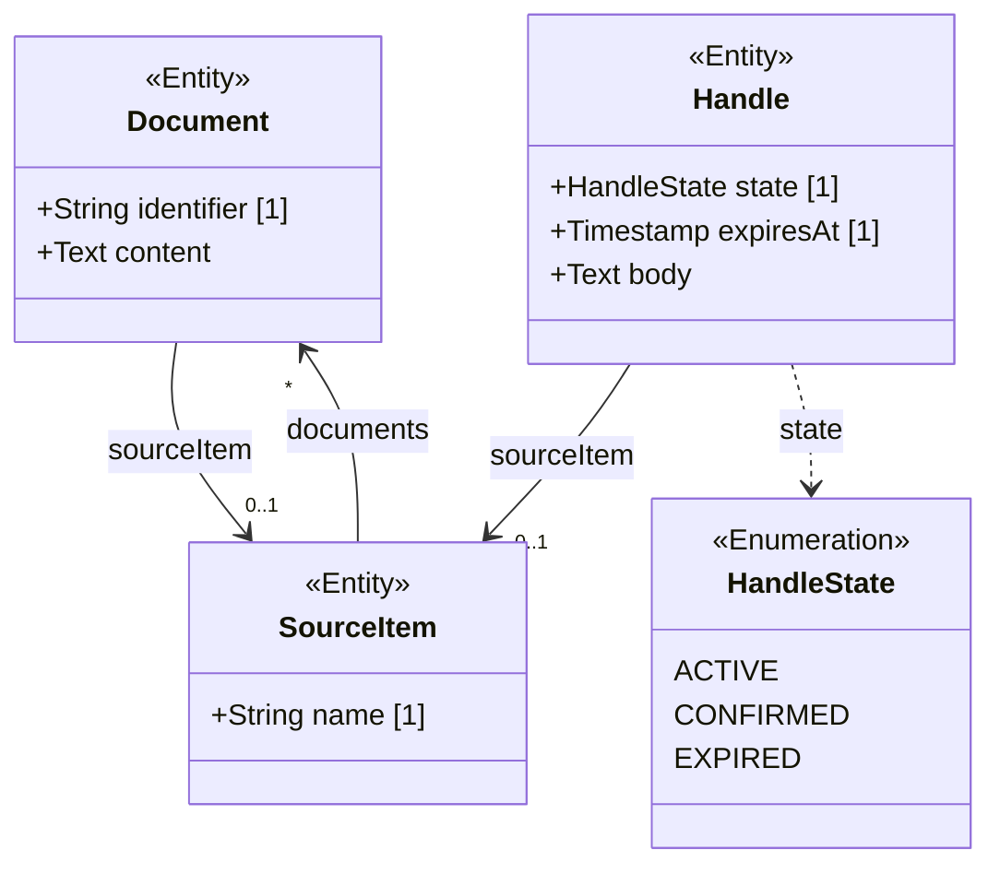

## Model shape

Three kinds of element: the Handle and Document entities, the HandleState enumeration, and the project's source entities.

### Handle entity

- `state`: `HandleState` (ACTIVE, CONFIRMED, EXPIRED), required.
- `expiresAt`: timestamp, required. Set at start to now plus a time to live (a project constant or configuration value).
- `body`: long text, optional inline content.
- An optional overflow binary for content too large for the inline text.
- One 0..1 association per source entity (a template, a data object, a design in the source project).

### Document entity

- `identifier`: string, required. The external reference, generated at confirm.
- `content`: long text, optional.
- An optional final file binary, 0..1, for output types that render a separate file (for example a PDF). Text-only output types leave it empty.
- The same 0..1 associations to the source entities as the Handle.

### Source entities

Each source entity may hold a 0..* association to Document, so the provenance chain can be read from the source side as well. All of these are associations, so deleting a source never deletes its Documents.

### Access and generated UI

Both entities are non-createable, non-updateable and non-deletable. The generated pages for them must be hidden or left out of the actor's menu: clients reach the data only through the start and confirm operations, which are custom operations (see [[custom-operation-osgi-component]]). If the Document should be browsable, expose it through a read-only access on a mapped transfer object and keep create, update and delete off.

The state value is part of the model so the confirm check (state must be ACTIVE) and any admin view can read it. Expiry itself is not a model feature: it is the comparison of `expiresAt` with the current time inside the confirm operation.

The fragment drawn below uses a neutral `SourceItem` and leaves out the binary attributes, because the fragment base model has no binary type.

## Structure diagram

