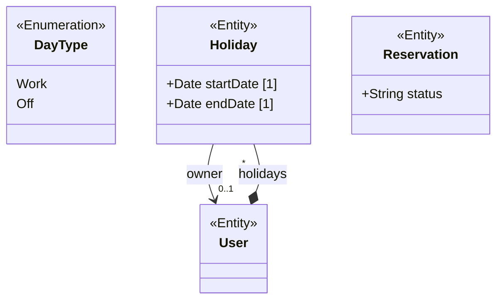

## Model shape

The User entity composes its holidays. Each Holiday has a required start date and end date, and a derived relation `owner` back to its owning User (container navigation). The User-to-Holiday relation is a composition. The DayType enumeration (Work, Off) marks single-day calendar overrides. The Reservation entity is next to the holiday because a new holiday can affect existing bookings.

Generated UI pages: the holiday list and form sit on the user's own panel (composition table and form). Keep the generated Table and Form for holidays there. Because creation is a custom operation that also touches reservations, hide the plain generated create control if it would skip the overlap check ([frontend.md](frontend.md)).

## Structure diagram

