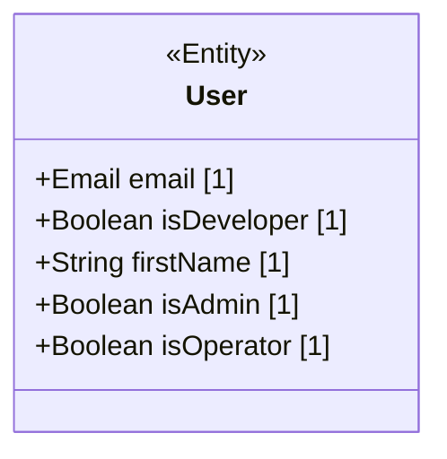

## Model shape

The User entity has a first name, an email as the identifier, and one required boolean per role (admin, developer, operator, and others). There is no role entity and no role enumeration. Each role check reads one flag on the user.

If the user is the principal of a managed actor, the flags are projected as mapped attributes of the principal transfer object, so expressions can read them as actor variables ([platform pattern](../../agent-docs/model/advanced-modeling-patterns.md#pattern-role-flags-on-the-principal-entity)). Generated UI pages: keep the View and Table pages for the user; show the flag editing controls only to administrators with an update access, since the flags grant rights.

## Structure diagram

<!-- mermaid:generated fragment=user-with-boolean-role-flags cli=1.1.0.20261108_202643_d9769d90_develop -->

<!-- /mermaid:generated -->
