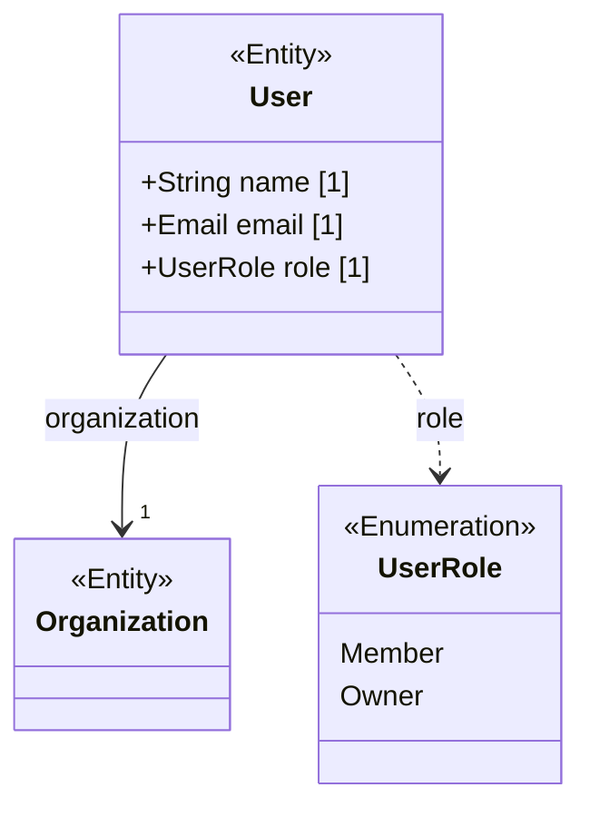

## Model shape

The User entity has a name, an email as the identifier, and a required role from the UserRole enumeration (Owner, Member). It has a required association to one Organization. Role checks are made in the context of that organization.

Generated UI pages: the User View, Form and Table pages show the role and a link to the organization. Hide the role control for users who may not change roles, and keep the organization association read-only on the Form once the user exists, since changing it moves the user between organizations. See [frontend.md](frontend.md) for the custom profile panel.

## Structure diagram

