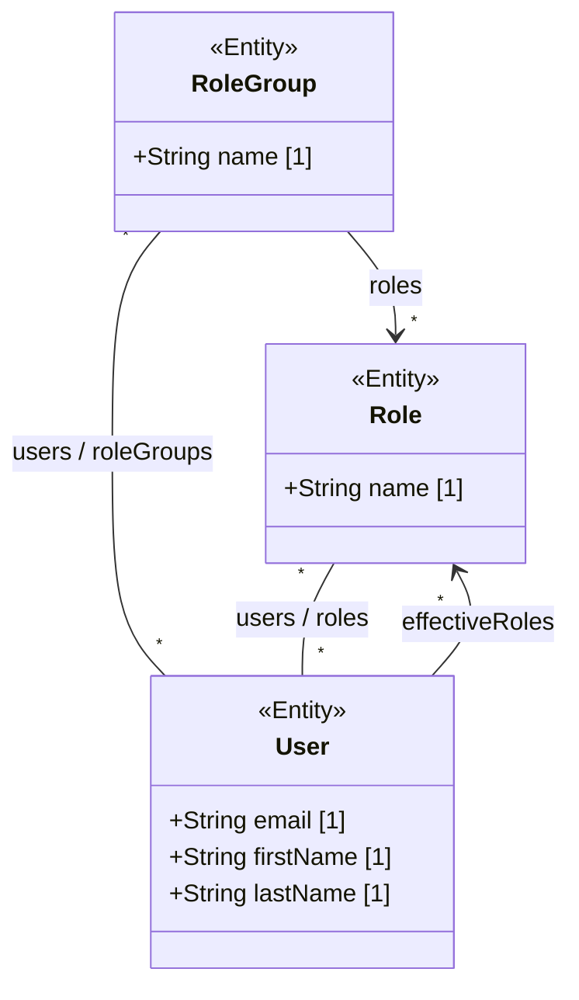

## Model shape

Three entities and two many-to-many relations around the user.

- **User** has a required email, first name and last name. It is associated many-to-many to Role (`roles`) and to RoleGroup (`roleGroups`), both bidirectional. `effectiveRoles` is a derived collection of Role. Its getter is the direct `roles` in this shape.
- **Role** has a required name and the back-reference `users`.
- **RoleGroup** has a required name, a one-way association `roles` to Role, and the back-reference `users`.

Access: the administrator actor reaches users, roles and role groups through accesses to mapped transfer objects with create, update and delete. The user transfer object shows `effectiveRoles` as a read-only relation.

Generated UI pages follow from the entities and the transfer objects: a Table and a View/Form page per type. Keep the relation pickers for `roles` and `roleGroups` on the user Form. Hide the `effectiveRoles` control from edit forms, since it is derived and read-only. On the role group Form keep the role picker, which is the only place a group's roles are set.

## Structure diagram

<!-- mermaid:generated fragment=user-with-role-and-rolegroup-entities cli=1.1.0.20261108_202643_d9769d90_develop -->

<!-- /mermaid:generated -->
