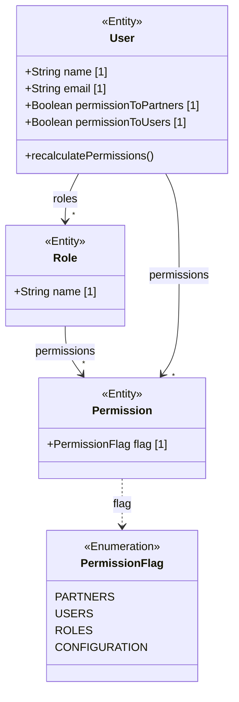

## Model shape

Four elements make the permission graph, with a stored copy on the user.

- **PermissionFlag** enumeration: one member per application area.
- **Permission** entity: a required flag (PermissionFlag).
- **Role** entity: a required name and `permissions`, a one-way association to Permission (0..*).
- **User** entity: required name and email, `roles` (one-way association to Role, 0..*), the derived `permissions` collection (`self.roles.permissions`), one required boolean per area with default false, and the custom instance operation `recalculatePermissions`.

The operation is declared `customImplementation` and stateful, so its body is Java in the backend. It reads the derived collection and writes the user's booleans.

Generated UI pages follow from the entities: Table and View pages for users, roles and permissions. The example makes the three entities non-createable, non-updateable and non-deleteable, so edits go through mapped transfer objects exposed to the administrator actor. Keep the role picker on the user Form and the permission picker on the role Form. Hide the denormalized booleans from edit forms: they are written only by the operation. Show the recalculate action on the user View for administrators.

## Structure diagram

<!-- mermaid:generated fragment=user-with-role-permission-entity cli=1.1.0.20261108_202643_d9769d90_develop -->

<!-- /mermaid:generated -->
