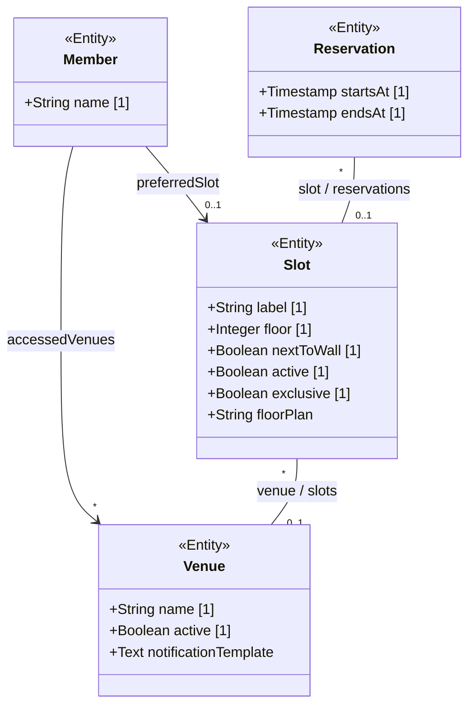

## Model shape

The shape has a venue that holds individually bookable slots, a reservation per slot, and a member who may book in some venues. It is a three-tier structure: venue, slot, reservation.

- **Venue** is the container. Attributes: name (required string), active (required boolean) and notificationTemplate (optional text) for notification mails.
- **Slot** is one bookable unit. Attributes: label (required string), floor (required integer), nextToWall (required boolean), active (required boolean), exclusive (required boolean, a slot reserved for privileged members) and floorPlan (optional string reference to a plan image).
- **Venue.slots** and **Slot.venue** are one bidirectional pair: the venue end is a collection (0..*), the slot end is a single back-pointer (0..1 in the generated pair). Both ends are association kind. The platform validator refuses composition on a bidirectional pair, and an aggregation end needs an association partner; association on both ends is valid. See [[bidirectional-relation]].
- **Reservation** is a booking with startsAt and endsAt (required timestamps). **Slot.reservations** (0..*) and **Reservation.slot** are a second bidirectional association pair. Reservation detail belongs to [[reservation-booking-entity]].
- **Member** stands for the user. It has two unidirectional associations: accessedVenues (0..*, the venues the member may book in) and preferredSlot (0..1, the default slot for new bookings).

Access control is a model concern. Which venues a member sees comes from accessedVenues; the member-facing slot choice is a reference range that the backend narrows (see [backend.md](backend.md)). The shape also implies transfer objects: a settings transfer object for the venue with its slots (administrator view), a settings transfer object for one slot, and a reduced slot view with only the booking-relevant attributes. The `Venue`, `Slot` and `Member` names are neutral stand-ins for any site with bookable units and the people who book them.

The denormalised venue name on the slot and the aggregated display name of a slot are derived or copied values; prefer a derived attribute (computed on read) so the name cannot drift.

Generated UI pages follow from the entities: keep the table and view pages of Venue for administrators, keep the Slot form for editing physical descriptors, and hide the Reservation pages from members who should only book through the booking form.

## Structure diagram

