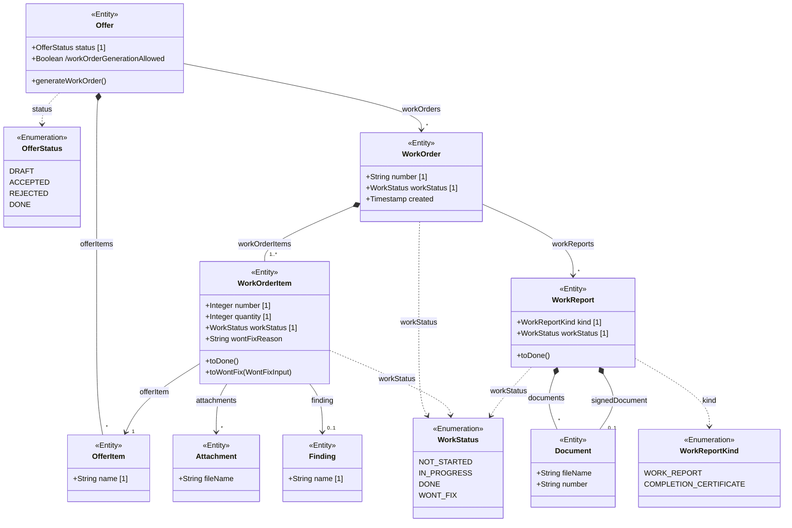

## Model shape

The shape has eight entities, three enumerations and one transfer object for the won't-fix input.

**Offer** is the root. It holds a required `status` of the `OfferStatus` enumeration (draft, accepted, rejected, done) and offer items (composition, 0..*). Its derived Boolean `workOrderGenerationAllowed` is true only when the offer is accepted and no work report of kind COMPLETION_CERTIFICATE exists under its work orders. The instance operation `generateWorkOrder` creates a work order from the offer. It is custom, so its body is written by hand.

**WorkOrder** has a `number`, a `created` timestamp and a required `workStatus` of the shared `WorkStatus` enumeration. It composes at least one `WorkOrderItem` and associates zero or more `WorkReport` entries.

**WorkOrderItem** has a `number` (the position inside its finding), a `quantity`, a required `workStatus`, and an optional `wontFixReason`. It refers to exactly one `OfferItem` and optionally to one `Finding`, and it associates zero or more `Attachment` entries as photos. Two instance operations change its status:

- `toDone()` moves the item to DONE. It is custom, and the guard requires at least one attachment.
- `toWontFix(input)` moves the item to WONT_FIX. Its input is the `WontFixInput` transfer object with one transient `reason` string, which is stored on the item.

**WorkReport** has a required `kind` (`WorkReportKind`: WORK_REPORT or COMPLETION_CERTIFICATE, default WORK_REPORT) and a required `workStatus` (default IN_PROGRESS). It composes zero or more generated `Document` entries and at most one `signedDocument`. Its custom `toDone()` operation checks the documents before it moves the report to DONE.

**Document** and **Attachment** each hold a file name. A document also has a `number`, taken from a document number sequence when the document is created.

**Finding** has a required `name`. **OfferItem** has a required `name` in this shape; the offer item's pricing and quantity logic are not part of the shape.

The `WorkStatus` enumeration has four members: NOT_STARTED, IN_PROGRESS, DONE and WONT_FIX. It is the same enumeration described in [[work-status-lifecycle-enum]].

### Pages the shape implies

Generated pages give an offer view with a work order table, a work order view with its item table, and a work report view. Keep the generated view and form pages. Hide the generated action for `generateWorkOrder` and for both `toDone` operations when their guard is false; see the frontend guidance.

### Access

Make the offer the access root. Work orders, items, reports and documents are reached through it. Attachments of an item are reached through the item.

## Structure diagram

<!-- mermaid:generated fragment=work-order-report-completion-pipeline cli=1.1.0.20261108_202643_d9769d90_develop -->

<!-- /mermaid:generated -->
