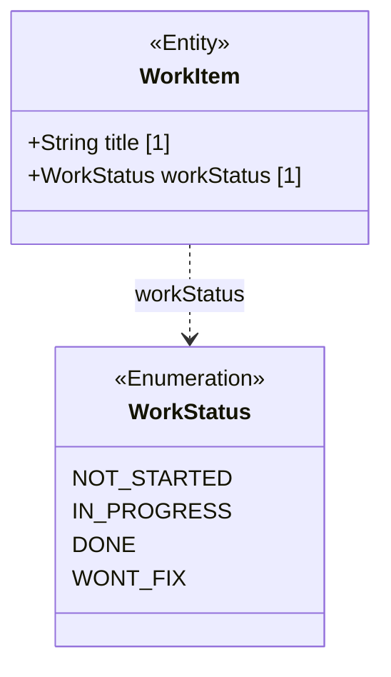

## Model shape

The shape is one enumeration, `WorkStatus`, with four members: NOT_STARTED (0), IN_PROGRESS (1), DONE (2) and WONT_FIX (3). A WorkItem entity carries a required `title` and a required `workStatus` attribute of type `WorkStatus` with a default value expression naming one literal.

The source project has two entities with this attribute: a job sheet and a work report, both defaulting to IN_PROGRESS. The work report adds start time, end time and number of workers. These entities and their relations are not part of the shape; only the enumeration and its use as a required attribute are.

Generated UI pages: the enumeration attribute appears as a selection on the form and as a column on the table. If the status must change only through operations, mark the attribute read-only on the generated form and expose the operations instead.

## Structure diagram

<!-- mermaid:generated fragment=work-status-lifecycle-enum cli=1.1.0.20261108_202643_d9769d90_develop -->

<!-- /mermaid:generated -->
