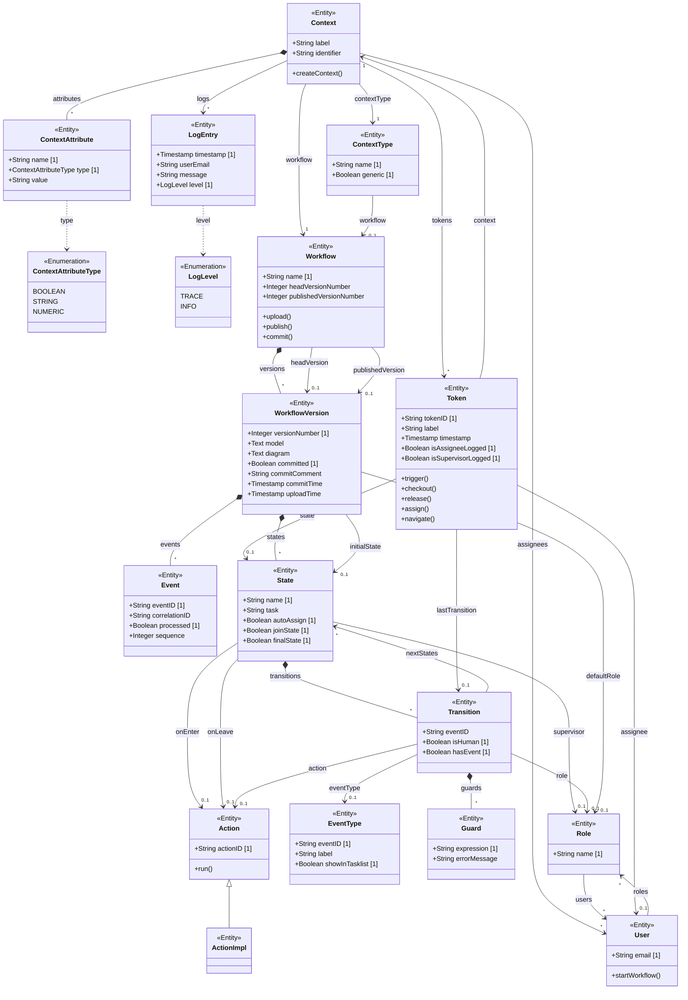

## Model shape

The shape is the entity cluster described in the blueprint, drawn with its custom operations and two enumerations. Names are neutral and follow the source project's own vocabulary because they are the engine's domain terms.

- Ownership: Workflow owns WorkflowVersion; WorkflowVersion owns State and Event; State owns Transition; Transition owns Guard; Context owns ContextAttribute. These are compositions. Everything else is an association; Token, Context, Role and User are free-standing.
- Pointers: head and published version on Workflow, initial state and default role on WorkflowVersion, onEnter, onLeave and supervisor on State, event type, action, role and next states on Transition.
- Action is specialized by a concrete subtype to show the strategy hook; each subtype implements run.
- Operations are instance or static custom operations: Workflow upload, publish, commit; Context createContext (static); Token trigger, checkout, release, assign, navigate; Action run; User startWorkflow.
- Not drawn: the transfer objects (task list, task, admin projections, inputs), derived relations (assignees, last transitions, authorized users) and the actor access that exposes them. They are implied by the engine and are project specific.
- All core entities have create, update and delete switched off; the UI reaches them through the task list and admin transfer objects.

Generated UI pages: keep the task list table and the task view as the main user screens, hide generated forms for the core entities, and use the admin projections for definition upload and version history.

## Structure diagram

<!-- mermaid:generated fragment=workflow-engine-state-machine-cluster cli=1.1.0.20261108_202643_d9769d90_develop -->

<!-- /mermaid:generated -->
