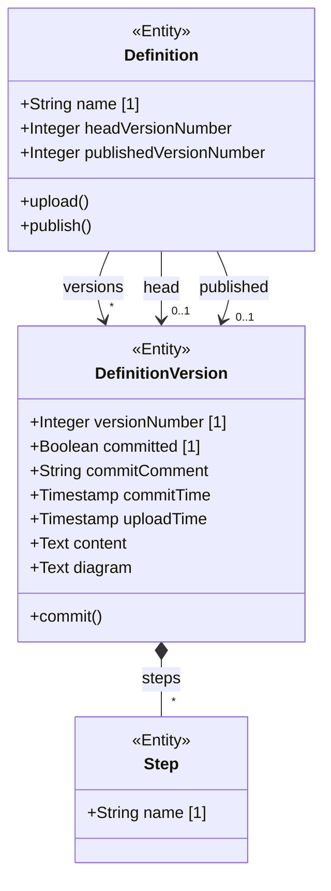

## Model shape

Three entities and three operations.

- **Definition** holds name, headVersionNumber and publishedVersionNumber, and three associations to DefinitionVersion: versions (0..*), head (0..1) and published (0..1). The pointers are independent: head is updated by upload, published by publish.
- **DefinitionVersion** holds versionNumber (required), committed (required, default false), commitComment, commitTime, uploadTime, content (text) and diagram (text). It owns Step entities (0..*, composition), the stand-in for the structural elements of a definition.
- **Operations**: upload and publish on Definition, commit on DefinitionVersion; all are instance operations with custom implementations.

The source project adds a back-pointer from version to definition (1..1) so a version can be opened on its own. A bidirectional pair needs the owner end to be an association or aggregation and the partner an association, because composition is rejected on a bidirectional pair; a unidirectional version-to-definition association would also work.

Transfer objects: an admin view of Definition (with the versions relation and upload), an admin view of DefinitionVersion (content, diagram, version number and commit), and two small inputs, an upload input carrying the file and a commit input carrying the comment. The file attribute uses the binary upload-token flow: the client gets a token, uploads the content, then sends the token with the operation.

Generated UI pages: keep the admin Definition table and view, keep the version table as an inline table of the definition, and hide generated create and edit forms for DefinitionVersion; versions come from upload only.

## Structure diagram

