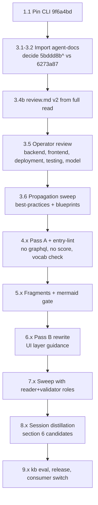

# Catalog update report: agent-docs, model blueprints, best practices

What needs to change in the catalog, based on four sources:

- a full, validated read of judo-ng;
- 550 real development sessions;
- the new `judo-model-cli`;
- the open tasks of this change.

This report is input for operator review (tasks 3.5, 4.x, 6.x, 7.x, 8.x). Nothing in it has been applied to the catalog yet.

## 1. Summary

1. **agent-docs have confirmed wrong API facts, and they spread.** Wrong interceptor signatures, exception types, hook keys, env vars and test-fixture APIs are in `agent-docs/`. The same claims were copied into best-practices and model blueprints, for example:
   - `getOperations()` in 5 files;
   - `ExceptionUtils` in 13 files (9 outside agent-docs);
   - `GenericOperationErrorException` in 4 files;
   - `JUDO_PLATFORM_*` env vars in 2 files.

   Fix agent-docs first, then sweep the same claims out of the other two areas.
2. **Model blueprints still carry the old generation format.** They have 1,187 ```` ```graphql ```` fences and 73 `score:` lines, and best practices have 207 more `score:` lines. All of these go away in Pass A (task 4.4).
3. **Best practices and blueprints present project code as platform API.**
   - 101 platform-looking identifiers do not exist anywhere in judo-ng: 54 in best-practices and 47 in blueprints. Examples: `WorkflowUtils`, `ActorService`, `RealmManager`, `DiagramUtils`, `PartnerUpdateInterceptor`.
   - They are helpers from the swept projects. Entries must label them as example project code, or describe them abstractly.
4. **Real developers struggle with UI and model decisions and with reading the model, more than with CLI syntax.**
   - **UI and page decisions** were the largest `ask_user` category: 419 decisions in 160 sessions. Model design decisions came next (289 in 130 sessions).
   - **Model shape** drew the most user corrections: 106 corrections in 80 sessions.
   - **Reading the model** caused the most errors. Parsing GraphQL JSON with ad-hoc python or jq failed about 204 times in about 75 sessions.
   - **The catalog gaps:** it lacks UI decision guidance, and it does not teach the new read path (`query`, `status --json`, `mermaid`).
5. **The CLI has changed under the docs.** Most of what developers read most is the GraphQL-mutation skill (`judo-model-cli-mutations`, 1,001 reads). The pinned CLI (`judo-model-cli@9f6a4bd`) replaces it with element commands, `query`, `mermaid` and `fix` lines. The catalog must not teach CLI syntax, as decided in the proposal. agent-docs `model/judo-cli.md` and the consumer skill switch-over (task 9.4) must point at the CLI's own `judo-cli` skill.
6. **Validated reading works, and its results show where the catalog needs a validation step.**
   - **Reader facts were accurate:** 3 wrong in 761 sampled (0.4%).
   - **Flagged items** (DOX disagreements, doc conflicts, suspected bugs) were 91% confirmed. 133 of the 186 that were wrong were suspected bugs.
   - **What follows:** any "known bug" or "do not use X" statement in the catalog must come from a validated finding, never from one reader.

## 2. Evidence base

| Source | Scope | Where |
|---|---|---|
| judo-ng full read | 103 repos, 577 batches (606 incl. splits), ~10,000 files; 461 batches validated, the rest had nothing flagged | `target/judo-ng-read/digest/<repo>.md`, `findings.md`, `findings_rows.json` |
| Validator results | 2,801 flagged items checked: 2,560 confirmed, 33 omission, 186 reader wrong, 22 imprecise | `target/judo-ng-read/out/*.validate.json` |
| agent-docs pass 1 | 56 findings across 6 areas (38 of 70 docs) | `target/agent-docs-review/review.md` |
| Catalog cross-check | Identifiers the catalog cites, checked against the judo-ng vocabulary (247k identifiers) | `target/judo-ng-read/catalog_missing_ids.json` |
| Developer sessions | 550 pi sessions (2 developers, rackinspect), CLI audit log (~8,100 calls) | outside the repo (`~/Sessions`), aggregates only |
| New CLI | `judo-model-cli@9f6a4bd`: `judo-cli` skill docs, `cli-tester` findings 0019–0039 | `digest/runtime__judo-model-cli.md` |

Session numbers come from keyword classification, so read them as indications. Task 8's distillation, which needs a pattern in at least 3 sessions plus review, is what confirms them.

Findings by kind and where they sit in judo-ng:

| Kind | Code | openspec | README | agent-docs | skills |
|---|---|---|---|---|---|
| doc conflict | 534 | 508 | 179 | 149 | 35 |
| suspected bug | 1,189 | 3 | – | 18 | – |
| DOX disagreement | 248 | – | 1 | – | – |

## 3. agent-docs: what to update

agent-docs come first (task group 3). Two sets of findings apply:

- **(a) Pass-1 findings:** 56, listed in `review.md` and still awaiting the operator's decision.
- **(b) Full-read findings:** 149 doc conflicts and 18 suspected bugs inside judo-ng's own agent-docs and skills.
  - 90 in `judo-runtime-core`, which ships agent-docs for the dispatcher, DAO, expressions and the testkit.
  - 58 in the fullstack template's agent-docs at `6273a87`.

  Many describe the same APIs our docs copy.

### 3.1 Backend (BE-001…012 plus runtime-core findings)

| Fix | Correct fact (validated) |
|---|---|
| Interceptor interface | `getOperations(AsmModel)` returns operations; `postCall` signature and `throws` per `OperationCallInterceptor`; document `async`, `terminateOnException` and `ignoreDecoratedCall` defaults (BE-001…004) |
| postCall order | `postCall` runs in **registration order**, not reverse; the doc claim "reverse order" in the runtime-core testkit docs is wrong |
| Dependency injection in examples | no `AccessValidationDao`, which does not exist (BE-005…007); the testkit `ReferenceInjector` injects by type and ignores `@Reference` and `@Inject` |
| Error handling | business errors are **modeled faults → generated `<Name>Exception`** (e.g. `BusinessErrorException` is generated per project); `ValidationException`, `AccessDeniedException` and `NotFoundException` are platform errors; `ExceptionUtils.createBusinessErrorException` and `GenericOperationErrorException` do not exist (BE-008/009) |
| Expression and DAO extension points | `getTransferObjectGraph` and `getTransferObjectBindings` return `Optional<…>`; `EntityTypeExpressions` fields are `getterAttributeExpressions` and `getterReferenceExpressions`; `Translator` has no `register()` (use the `getTranslators()` map) |
| Platform bugs worth a "known issue" note (validated) | `KeycloakLoginInterceptor` caches the deployment per realm and ignores the actor's client; `DefaultLiquibaseExecutor` swallows non-Liquibase exceptions; `PathInfoRealmExtractor` prefix match without a segment boundary |

### 3.2 Frontend (FE-001…018)

- **Hook interface keys and imports:**
  - Replace `CONTAINER_HOOK_INTERFACE_KEY`, `PAGE_ACTION_HOOK_INTERFACE_KEY` and the `@judo/web-react` imports with the generated, per-page/per-container keys (FE-006…013).
  - Generated hook names follow template helpers, such as `pageActionInterfaceKey` and `*_ACTIONS_HOOK_INTERFACE_KEY` prefixed by the page or container name.
  - Document that pattern, not fixed constants.
- **Generated output layout and `.tsx.default` handling** (FE-001…005, FE-014).
- **Missing topics:** menu actions hook, guest page registration, sub-theme hooks, cards-container config hook (FE-015…018).
- **Session signal:** UI/page decisions are the largest `ask_user` category, and UI corrections come second. The frontend docs need **decision guidance**, not only API reference:
  - table vs form vs view;
  - when to use action groups and FAB;
  - autocomplete vs selector.

### 3.3 Model (MO-001…008)

- **EVL constraint names and metamodel features:**
  - Fix these: `EntityTypeHasSelfMapping`, the `Mapping.target` type, `claimPrincipal`, and the UI `action` enum.
  - Source from `target/judo-ng-read/rules.json`, the deterministic list of all 613 EVL rules with error/warning severity. Do not take them from prose.
- **`model/judo-cli.md`:**
  - Replace the command reference with a link to the CLI's `judo-cli` skill, plus the 5 behaviours developers trip over (section 6).
  - Fix the `.model.dirty` marker text (MO-006) and the `transform` output list (MO-007).

### 3.4 Deployment (DE-001…009)

- **Fix:**
  - the `judo.sh` commands: add `dump`, `import`, `env` and schema upgrade;
  - the `judo-karaf.env` handling;
  - the outdated `JUDO_PLATFORM_DATASOURCE_*` and `JUDO_PLATFORM_FILESTORE_PATH` variables;
  - the `-DskipDocker` usage.
- **Session signal:** deployment docs were the 3rd most read (254 reads), and karaf/runtime errors appeared in 39 sessions. This area is high priority despite having only 9 findings.

### 3.5 Integration and e2e testing (IT-001…004, E2E-001…005)

- **Integration testing:**
  - The testkit packages are in the runtime-core testkit, not `…jsl.fixture`.
  - There is no `JudoTestFixture` parameter injection and no `fixture.begin()`, `commit()` or `rollback()`.
  - `truncateTables` semantics need correcting.
  - Error message texts in troubleshooting differ from the real ones. The runtime-core testkit docs have the same drift.
- **e2e:**
  - Fix row selection and the locator patterns.
  - Fix the URL pattern.
  - Replace "retries 4 on CI only": the template sets `retries: 4` unconditionally. This is a confirmed template bug.

### 3.6 Coverage gap

- Pass 1 checked 38 of 70 docs. The full read covers all judo-ng sources, so the unchecked 32 docs can now be verified against the digests without new explorer runs.
- **Proposal:** replace task 3.4's remaining explorer pass with a digest-based check (section 8).

## 4. Model blueprints: what to update

| Change | Scale | Task |
|---|---|---|
| Remove GraphQL fences (they become fragments plus generated Mermaid) | 1,187 fences in 105 `model.md` | 4.4, 5.x, 6.2 |
| Remove `score:` | 73 lines | 4.4 |
| Correct inherited agent-docs errors in `backend.md` and `frontend.md` | `getOperations()` in 4 files, `ExceptionUtils` in 3 | 6.2 (apply after 3.5) |
| Label project helpers as example project code (`ActorService` ×8, `RealmManager` ×4, `WorkflowUtils` ×3, `*Interceptor` classes named after project entities) | 47 identifiers | 6.2 |
| Verify frontend hook names (`FormActionsHook`, `AccessViewPageActionsHook`) against the template's generated naming | 2+ entries | 6.2 |
| Add UI layer guidance: which pages, tables and actions the shape implies | all model-shaped entries | 6.1 format, 6.2 |

The UI guidance answers the most frequent developer decision, and the CLI now generates those pages for us. Creating an entity or transfer object creates its View, Form and Table pages (`fixTransferUi`). Entries should therefore say which **generated** pages to keep, hide or customize, rather than describing pages from scratch.

## 5. Best practices: what to update

| Change | Scale |
|---|---|
| Remove `score:` | 207 lines |
| Fix error-handling practices to the fault-based model (`validation-exception-hierarchy`, `entity-re-fetch-pattern` and others citing `BusinessException` or `ExceptionUtils`) | 6 files use `ExceptionUtils`; `GenericOperationErrorException` in 1 |
| Interceptor practices: `getOperations(AsmModel)`, registration-order `postCall`, `terminateOnException` | `interceptor-*` files |
| Deployment practices: current env-var names | 1 file |
| Project helpers as platform API (`WorkflowUtils` ×8, `AccessRequest` ×5, `DiagramUtils` ×4, `GenericActor`, `ValidationErrorCode`) | 54 identifiers |
| New practices from sessions (candidates, to be confirmed by task 8) | see section 6 |

## 6. What real development sessions add

| Signal | Numbers | Catalog consequence |
|---|---|---|
| Model reads dominate | audit log: 6,521 GraphQL queries vs ~1,000 edits; only 143 `query` calls | best practice "read the model with `query esm <Type> --select --where`, `status --json` and `mermaid model`, not GraphQL plus ad-hoc parsing" (agent-docs `model/`) |
| Parsing GraphQL JSON breaks | ~204 failures in ~75 sessions (`'NoneType' object is not subscriptable`, `jq: Cannot iterate over null`) | same as above; also note that `--json` **errors** are still printed as text (CLI finding 0028), so scripts must check the exit code first |
| CLI resolution failures | `judo_cli` alias missing, `Unable to access jarfile` | one documented resolution order (`$JUDO_CLI_JAR`, then `target/`); this is already the script contract in task 2.3, so reuse it in the agent-docs |
| Non-existent options | `--filter fqn~…` (5 calls) | docs that invent options get copied; link to `--help`/`--schema` instead of listing options |
| UI/page decisions | 419 `ask_user` in 160 sessions | UI decision tables in frontend best practices and blueprint layer guidance |
| Model-shape corrections | 106 corrections in 80 sessions | "when to use / when to avoid" sections must be specific (composition vs aggregation, enum vs entity, TO projection) |
| Most-read docs | CLI mutations skill 1,001, CLI skill 514, deployment 254, i18n 187, testing 150, backend 88, model 70, e2e 65, frontend 62 | prioritise kb golden queries (task 9.1) and review order: model/CLI, deployment, i18n, testing |
| Dirty-state confusion | `.model.dirty` lookups, `status`/`discard` loops | agent-docs: save/discard/status lifecycle, and the "remove the dirty marker, restart" recovery |

All of these route through task 8 (consent, redaction, recurrence of at least 3 sessions, human review) before they become entries. CLI footguns go **upstream** to the CLI's `judo-cli` skill, not into the catalog.

## 7. Models: what generated the catalog, and what to use now

| Phase | Models | Observed quality |
|---|---|---|
| Original catalog | `.claude/agents/*-analyzer` (declared `model: sonnet`), `score-*.py` ranking | unvalidated; project code presented as platform API; agent-docs errors copied into entries |
| Developer sessions | Claude Opus 4.6–5.5 (~87k messages), DeepSeek v4.1 flash | source of the decisions and corrections in section 6 |
| agent-docs pass 1 | `claude-haiku-5-5`, 4 parallel | 56 findings; 38 of 70 docs |
| judo-ng full read | readers `claude-haiku-5-5`, then `inception/mercury-3`; validators `claude-opus-5-5`, then `mercury-3` | reader facts 0.4% wrong (sampled); flagged items 91% confirmed; ~5% of reader batches gave no output (split and retried) |
| Rejected | `claude-sonnet-5-5` | refused the reading task (policy); do not assign it to read or sweep roles |

What this means for the sweep and distillation roles (tasks 7.1a and 8):

- A cheap reader plus a validation of every flagged item is enough.
- Single-reader "suspected bugs" are the least reliable output (133 of 186 wrong verdicts) and need validation before any entry repeats them.
- Known false positives belong in the reader prompt up front:
  - `${java.version}`;
  - the release repo pointing at the snapshots URL;
  - empty EVL placeholders;
  - Handlebars `as |x|` scoping.

## 8. Effect on the open tasks of `restructure-blueprints-for-kb`

| Task | Status | What this report changes |
|---|---|---|
| 1.1 Pin the CLI | open | pin `judo-model-cli@9f6a4bd`, the SHA the read used; fragments and `mermaid` defaults (`--split aggregate`, `--kinds entity,enum`, `--depth 0`) are taken from it |
| 1.2–1.5 | open | unchanged |
| 2.1–2.9 | open | 2.5: the `.claude` analyzers' knowledge is low-trust (section 7); move only procedure, not facts |
| 3.1–3.2 Import | open | **decide the import base**: `develop` removed agent-docs (`5bddd8b`), but `feature/JNG-6349_AddZetaValidatiob@6273a87` still has them, and the read found 58 conflicts there; diff `5bddd8b^` against `6273a87` before importing |
| 3.3 kb-ify | open | seed golden queries from the most-read docs (section 6) |
| 3.4 judo-ng explorer pass | **superseded by the full read** | generate the per-area `review.md` from `findings_rows.json` (agent-docs/skills rows) plus pass 1 plus `catalog_missing_ids.json`; cover the 32 unchecked docs from the digests |
| 3.5 Operator review | **next step** | review in priority order: backend errors and interceptors, frontend hooks, deployment, testing, model |
| 4.1 entry-lint | open | add rules: no `score:`, no ```` ```graphql ````, and **flag platform-looking identifiers absent from the judo-ng vocabulary** unless marked as example code |
| 4.4 Pass A | open | expected removals: 1,187 GraphQL fences, 280 `score:` lines |
| 5.1–5.5 Fragments | open | `mermaid model` draws the in-memory model, unsaved edits included, so `render` must run after `save` in a clean scratch session; scripts must not parse `--json` error output as JSON (0028); avoid `move --index` (0037 open) |
| 6.1–6.3 Pass B | open | add the "layer guidance: generated pages" section; apply accepted 3.5 corrections to entries citing the same APIs |
| 7.1–7.4 Sweep | open | use `query esm --select --where` for model inspection; reuse the CLI repo's `model-reconstruction` results for rackinspect; reader + validator roles per section 7 |
| 8.1–8.3 Distillation | open | start from section 6's candidate list; route CLI footguns upstream |
| 9.1 kb eval | open | weight golden queries to the most-read areas |
| 9.4 Consumer switch | open | `judo-model-cli-mutations` is the most-read local skill (1,001 reads); the replacement (CLI `judo-cli` skill plus catalog agent-docs) must cover reads, element edits and the dirty lifecycle before it is removed |

### Proposed new tasks

- **3.4b** Generate `review.md` v2 from the full read: map each agent-docs heading to its validated findings, and include pass 1. Verify: every agent-docs file has a row, and every finding carries `repo@sha:path:line` and a validator verdict.
- **3.6** Propagation sweep: after 3.5, grep best-practices and blueprints for every corrected claim (the table in section 1) and fix them in the same PRs. Verify: 0 hits for each rejected pattern.
- **4.1b** `entry-lint` vocabulary check, using the judo-ng identifier vocabulary built at the pinned SHAs and stored outside the catalog.

## 9. Recommended order



## 10. Open questions for the operator

1. Which template state is the agent-docs import base: `5bddd8b^` or `6273a87`?
2. Should validated platform bugs (section 3.1) appear in agent-docs as "known issues", or go only to judo-ng issue tracking?
3. Is the `mercury-3` reader + validator setup acceptable for the sweep (task 7), or should validation stay on Opus?
