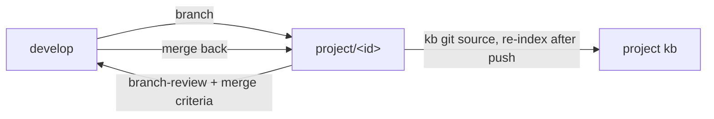

# Design

## Context

See `proposal.md` for the motivation. The facts that shape the approach:

- **Catalog:** 105 blueprints (4 files each) and ~222 best practices.
  - `score` is missing on 45 entries.
  - `model.md` holds ~1,169 GraphQL lines.
- **agent-docs:** 65 docs here (2026-03-05), against 70 non-domain docs in the template's last version `5bddd8b^`. The template deleted them on `develop` (`5bddd8b`, 2026-11-03) and names judo-blueprint as the owner.
- **judo-ng** (`~/Projects/judo-ng`, 103 repos): metamodels in `models/judo-meta-*`, runtime in `runtime/judo-runtime-core*` (41 package `agent-docs` files), generators in `template/*`, CLI in `runtime/judo-model-cli`.
- **CLI (`judo-model-cli` `develop` @ `9f6a4bd`, 2026-11-03):** see the capability table in `proposal.md`. The facts that matter here:
  - `mermaid model` renders the **in-memory** ESM, so a fragment file can be drawn directly with `-m fragments/<id>.model`;
  - the authoring commands (`create -t … --ns …`, `update`, `fill`, `relocate`, `move`, `split`) run as one transaction each, with `--dry-run`, `--schema` and `fix` lines;
  - `validate --strict` exits non-zero on any error;
- **kb engine:**
  - FTS5 heading chunks, max 4000 characters;
  - searchable keys: `title`, `description`, `aliases`, `keywords`;
  - facet keys: `tags`, `status`, `category`, `date`;
  - no block scalars;
  - the `git` source runs `clone --depth 1 --branch <pin>`.
- **pi packages:** `pi install git:<repo>@<tag>` pins the ref. `package.json` `pi.skills` lists the skill directories. Skills resolve `scripts/` relative to their own directory.
- **Versioning reference:** `judo-maven-plugin` `build.yml`, `create-release-on-master.yml` and `release.yml`.

## Goals / Non-Goals

**Goals:**
- Diagrams that cannot drift from what the CLI actually builds.
- Skills that are reusable outside this repo and installable at the same tag as the catalog.
- One script per deterministic step, used identically by the model, by people and by CI.

**Non-Goals:**
- Changing the CLI, kb or the distiller.
- Generating behaviour diagrams.
- Cleaning up consumer projects. Removal candidates there are only listed.
- A/B evaluation and reconstruction of blueprints in real projects: not planned.
- pi-flows orchestration of the sweep.
- A repeatable agent-docs/platform-knowledge update. The judo-ng verification is one-time; later changes are ordinary PRs.

## Decisions

### D1. Repository layout
```
package.json                      pi package: "pi": { "skills": ["./skills"] }, keywords ["pi-package"]
skills/                           exported, reusable
  judo-blueprint/                 SKILL.md, references/{search.md,apply.md}, scripts/pin-source
  judo-model-mermaid/             SKILL.md, references/{fragments.md,diagram-options.md}, scripts/{render,check}
  judo-blueprint-author/          SKILL.md, references/{format.md,model.md,backend.md,frontend.md,specs.md}, scripts/{scaffold-entry,entry-lint}
  judo-session-distill/           SKILL.md, references/{routing.md,privacy.md}, scripts/{distill-run,distill-route,redact-check}
.pi/skills/judo-catalog-maintain/ internal: SKILL.md, references/{sweep.md,agent-docs.md,release.md},
                                  scripts/{sweep-plan,clone-project,model-overview,custom-overview,record-sweep,projects.py,next-batch,
                                           check-all,version.sh,release-notes}
catalog/                          kb subdir for consumers
  best-practices/{model,backend,frontend}/<id>.md
  model-blueprints/<id>/{BLUEPRINT,model,backend,frontend}.md
  agent-docs/…                    (no domain/)
  **/AGENTS.md
fragments/<id>.model             ESM fragment models built and saved by the CLI (blueprints + model-shaped best practices)
tests/fixtures/Sandbox.model, tests/golden/kb-golden.json, tests/<script>/…
PROJECTS.md  README.md  AGENTS.md  pom.xml (revision, CLI download → target/)
```
**Why `skills/` at the root, not under `.pi/`:** pi package discovery reads the manifest paths. Dot-directories need explicit listing. Only reusable skills ship; the internal one stays project-local in `.pi/skills/`.

**Why `fragments/` is outside `catalog/`:** fragments are model files, not knowledge prose. Consumers index `catalog/` only. The catalog holds nothing but descriptions and Mermaid.

### D2. Fragments are CLI-built model files, not command lists
A fragment is `fragments/<id>.model`:
- a copy of the Sandbox model plus one package `bp::<id>` that holds the fragment;
- neutral names (`Order`, `OrderLine`, `AuditLog`, …);
- built by the author in a scratch session with the CLI authoring commands, then written by `save`.

No command list is committed anywhere.

**Why model data over a command list:**
- the user wants no CLI in the package, and a model file has no command syntax to go stale;
- consumers and the Designer can open a fragment as a normal model.

**Alternatives rejected:**
- YAML or GraphQL recipes: CLI syntax stored in the repo; breaks on syntax changes.
- Hand-written Mermaid: can drift from what the platform can express.

**Authoring sources:**
- the sweep reads the real project model with `mermaid model --scope … --depth 1` and `query esm`, then builds a neutral-named version with the CLI;
- the old GraphQL is read once from `archive/pre-kb-restructure`.

### D3. Diagram generation and the fragment gate
`render <id>` runs `mermaid model -m fragments/<id>.model --scope bp::<id> --split none` with the entry's diagram options (`diagram:` in frontmatter: `kinds`, `members`). It writes the output between `<!-- mermaid:generated fragment=<id> cli=<version> -->` and `<!-- /mermaid:generated -->` in `model.md` (blueprints) or the entry file (best practices).

`check <id>|--all` runs these steps, each in a scratch directory:
1. `validate --strict` on the fragment;
2. **render** in memory and diff against the generated block. A difference fails;
3. fail if the render shows an element outside `bp::<id>` other than `<<external>>` stubs of Sandbox types.

`entry-lint` rejects hand edits inside the markers.

**Why this is enough:** `validate --strict` proves the fragment is a valid model for the pinned CLI (ESM + UI constraints + transform dry-run); the render diff proves the diagram is what the CLI draws. Together they replace the old mutation-replay test without storing any commands.

### D4. Skill split (reusable first)
Each skill owns one job, and its `SKILL.md` description names exactly when to use it. This avoids routing overlap.

| Skill | Job | Depends on |
|---|---|---|
| `judo-blueprint` | consumer side: search and apply entries, pin the catalog tag in kb config | kb tools |
| `judo-model-mermaid` | render or check Mermaid for a fragment; also diagram a scope of the user's own model | CLI jar |
| `judo-blueprint-author` | write or update one entry: description, build the fragment with the CLI in a scratch Sandbox (`--schema`, `fix` lines; CLI repo `judo-cli` skill docs), `save`, call `render`, lint | `judo-model-mermaid`, CLI `judo-cli` skill |
| `judo-session-distill` | sessions → routed, redacted candidates | distiller npm package |
| `judo-catalog-maintain` (internal) | sweep, batch rewrite, agent-docs sync, all gates (`check-all`), version and release | the other four |

**Alternative rejected:** one big skill. It isn't reusable outside this repo, and consumers would load maintenance instructions they never use.

**Alternative rejected:** 9 fine-grained skills. Their descriptions overlap, and shared scripts end up duplicated.

### D5. Scripts contract
- POSIX shell or Python 3, with no dependencies beyond the JDK (CLI), Node (`mmdc`, kb, distiller) and git.
- Every script supports `--help` and `--json`, exits non-zero on failure, and resolves paths relative to its own location. It can be run from any cwd.
- CLI resolution order: `$JUDO_CLI_JAR`, then `<repo>/target/judo-cli.jar`, then a clear error with the download command.

### D6. Frontmatter
```yaml
id: audit-log-entity
title: Audit Log Entity
description: One line used by kb and AGENTS.md rows.
aliases: [audit trail, event log]
keywords: [audit, timestamp, immutable]
tags: [domain:model, layer:backend, project:rackinspect, status:established]
category: entity
status: established
projects: [rackinspect, mlszksz-platform]
evidence: [rackinspect@489ab5b:model/rackinspect.model, session:01a13a68]
alternatives: [audit-event-trail]
fragment: audit-log-entity        # or "none: <reason>" for infra/backend/frontend-only entries
diagram: { kinds: [entity, enum], members: types }
first_seen: 2026-03-05
last_updated: 2026-11-10
```

### D7. Migration in two passes
- **Pass A (scripted, one PR):**
  - move content to `catalog/`;
  - convert frontmatter (drop `score`/`usage_count`/`alternative_count`);
  - delete GraphQL blocks and `CONVENTIONS.md`;
  - wikilink `alternatives`;
  - insert section skeletons;
  - generate `AGENTS.md`;
  - set `format: legacy`.

  Before deleting anything, create the tag `archive/pre-kb-restructure` on the last pre-change commit.
- **Pass B (skill-driven, reviewed, ~10 entries per PR):** for each entry, `judo-blueprint-author` writes the abstract text, builds the fragment with the CLI (input: the pre-change GraphQL via `git show archive/pre-kb-restructure:…`, plus source evidence), saves it, runs `render`, `check` and `entry-lint`.

### D8. agent-docs first: one-time import, kb-ify, verify against judo-ng
Phase P1b, right after the layout move and before Pass A. Everything here is **one-time** and lives in `openspec/changes/restructure-blueprints-for-kb/oneoff/` (scripts and subagent prompts), so it is archived with the change and **no skill contains it**.

1. **Import** (`oneoff/agent-docs-import`): read `agent-docs/**.hbs` from the template at `5bddd8b^`.
   - Render the Handlebars: `docLink`/`localHubLink` become relative links, `lowerCase model.name` becomes `<app>`, `#if` keeps both branches with labels, `\{{` becomes `{{`.
   - Rewrite skill wording (no `SKILL.md`, `.claude/`, judospec).
   - Drop `domain/`.
   - Three-way merge with the current catalog docs and the `feature/cciu-model-patterns` additions, so catalog-only content is kept.
2. **kb-ify:**
   - frontmatter `title`/`description`/`aliases`/`keywords`/`tags`/`status`;
   - headings sized to kb chunks (≤4000 characters);
   - wikilinks between docs and to catalog entries;
   - a DOX `AGENTS.md` per `agent-docs/` directory;
   - ~20 agent-docs golden queries in `tests/golden/kb-golden.json`;
   - `kb dox lint` and `entry-lint` (agent-docs profile) clean.
3. **Verify against judo-ng (review-gated):** one explorer subagent per doc area, run in parallel, read-only on a judo-ng checkout at recorded SHAs.

   | Doc area | judo-ng sources |
   |---|---|
   | `model/` | `models/judo-meta-esm`, `judo-meta-ui`, `judo-meta-expression*`, `judo-meta-measure` (ecore + EVL constraints), `runtime/judo-model-cli` |
   | `backend/` | `runtime/judo-runtime-core*` (dispatcher, DAO, accessmanager, security, expression) and their package agent-docs, `judo-dispatcher-api`, `judo-dao-api`, `osgi-*` |
   | `frontend/` | `template/judo-ui-react-template`, `judo-ui-typescript-rest-template`, `models/judo-meta-ui` |
   | `integration-testing/` | `runtime/judo-runtime-core-esm-itest`, `template/judo-psm-generator-restassured`, `judo-psm-generator-sdk-core` |
   | `e2e-testing/` | `template/judo-ui-e2e-template` |
   | `deployment/` | `template/judo-esm-fullstack-project-template` root, `packages/karaf-features`, `runtime/osgi-liquibase`, `judo-rdbms-schema`, `models/judo-meta-liquibase`, `judo-meta-keycloak` |

   Each finding is written to `target/agent-docs-review/<area>.json`: doc path and heading, the claim, verdict (`correct` / `wrong` / `outdated` / `missing`), code evidence `repo@sha:path:line`, and a proposed text. **The operator reviews every finding** in one review file (`review.md`, generated from the JSON) and marks each one accept, reject or edit. Only accepted findings are applied, by an author subagent. A doc change without an accepted finding fails review.
4. **Later:** agent-docs change through ordinary PRs. A sweep that notices an agent-docs problem adds it to a review list in its PR body; it never edits agent-docs itself.

**Static lint stays** (part of `entry-lint`, agent-docs profile): no Handlebars outside fences (fence-aware, so JSX passes), no harness wording, no sample project names (`webshop`), no `domain/`. There is no template parity check and no cross-repo gate.

### D9. Distillation
`judo-session-distill`:
1. `distill-run` (wraps `distill-session-knowledge --sessions-dir <d> --cwd <repo> --n 3 --json`, dry-run);
2. `distill-route` (rules first; the model decides the rest, following `references/routing.md`);
3. authoring via `judo-blueprint-author`, in the project's contribution branch (D14);
4. `redact-check`;
5. `branch-review` and a maintainer merge into `develop`.

The watermark and decision log live in `.pi/distill/state.json` (ids and hashes only). `MEMORY.md` is optional reviewer reading; there is no dedicated miner.

### D10. Sweep
`judo-catalog-maintain` sweep:
1. `sweep-plan` resolves the remote branch and SHA, dedupes worktrees, and keeps resume state;
2. `clone-project` makes a shallow clone into a temp directory;
3. **model overview first:** `model-overview` prints the whole source model with the CLI, read-only, into `target/sweep/<project>/<sha>/` (gitignored):
   - `shape.md`: `mermaid model --md --members none` (one diagram per aggregate; about 6.5k tokens for rackinspect's 95 entities);
   - `domain.md`: `mermaid model --md --members types` (about 10.5k tokens);
   - `access.md`: `mermaid model --md --split package --kinds transfer,actor --members none`;
   - `counts.txt`: entities, enums, compositions, generalizations, transfer objects, actors.

   Then `custom-overview` writes `custom.md` to the same folder (rules and read order in D10a). It is an inventory of the project's custom code, found by JUDO conventions rather than per-project paths:
   - **custom frontend:** registrations in `src/custom/application-customizer.tsx` (actions hooks, container actions hooks, custom implementations replacing generated groups, table-row highlighting, logo props, access filters), plus other files under `src/custom/` (components, utils) and `generator-overrides/` (template overrides, assets);
   - **interceptors:** classes implementing JUDO runtime interfaces (`OperationCallInterceptor` with `preCall`/`postCall`, registered via `@Component(property="judo.model.name=…")`), and project abstractions built on them (e.g. a write guard with permitted roles and an operation list);
   - **custom backend code:** operation implementations and services in the application modules.

   Each item is mapped to the model element it targets, using the generated interface key path for frontend hooks and the operation name for interceptors. The inventory is grouped by mechanism and by target. Unmapped items are listed separately.

   The model reads `shape.md` in full, then `domain.md`, then `custom.md`, and lists candidates. A candidate is a model shape together with the custom code it relies on, e.g. "header/line aggregate + range interceptor + row-highlighting hook". Frontend or backend customization patterns that recur without a model shape become best-practice candidates. Typical candidates: aggregate shapes, status enums and lifecycles, header/line compositions, audit and soft-delete fields, registries, actor and access patterns, guarded writes, range/filter interceptors, custom form actions. Each candidate is matched to an existing entry (new evidence) or marked new;
4. the model drills down only where a candidate needs it: `mermaid model --scope <element> --depth 1`, `query esm` for operations, and the backend, frontend and specs code following `judo-blueprint-author/references/<layer>.md`;
5. author entries (new evidence, or a new entry with a neutral fragment);
6. `check-all`;
7. PR. The PR body carries the counts and the candidate list (neutral names, the entry each one maps to, or `new`);
8. `record-sweep` updates `PROJECTS.md` on merge with the SHA, the counts and the candidate-to-entry list.

**Why the overview is never committed:** this repo is public, and the overview and the custom-code inventory contain the client's real domain names and code. Only counts and neutral candidate names leave the work folder, and `redact-check` runs on the PR body and the `PROJECTS.md` diff.

### D10a. Generated vs custom in a JUDO project (measured on rackinspect `3954ae1`)
The sweep only learns from code a developer wrote. A JUDO project mixes three kinds of files. `custom-overview` tells them apart with the project's own generator conventions:
- the generator's `.gitignore` blocks (`# JUDO GENERATOR BLOCK START`);
- `.generator-ignore`;
- `*.default` siblings.

It never relies on file headers.

**What is what**

| Area | Generated (not tracked, rebuilt by `judo.sh generate`) | Custom (tracked, the sweep reads it) | Generated *and* tracked |
|---|---|---|---|
| Model | derived PSM/ASM/RDBMS/UI models in `target/` | `model/*.model` (the source of truth; the overview reads it with the CLI) | |
| Frontend (`application/frontend-react/<actor>/`) | `src/{auth,components,components-api,containers,dialogs,pages}`, `src/services/data-api`, `data-axios`, `package.json`, … (≈8.4k files, listed in the app's `.gitignore` generator block). This includes **856 `customization.ts` files that declare the hook interfaces** (the extension points) | `src/custom/**` (180 files): `application-customizer.tsx` registers hooks by the generated interface keys, plus `hooks/{dialogs,pages,containers,custom-implementations,utils,…}`, `components/`, `src/__tests__/`, edited `public/i18n/*` | `src/custom/**/*.default` (20): the generator's current version of a file that the developer owns |
| Frontend generator overrides | | `generator-overrides/ui-react/**` (template `.hbs` overrides, assets); `generator-overrides/` at the application root | |
| Custom operations (`application/app`) | `*CustomImplementation.java.default` (245 on disk, ignored by `**/*.default`), whose stub body is `throw new UnsupportedOperationException("Operation not implemented …")` | `custom/<model>/<path>/<Op>CustomImplementation.java` (192, all differing from their `.default`). Each one `implements …operation.<model>.<path>.<Op>`, and that package path names the model operation | |
| Interceptors (`application/interceptors`) | | 86 classes: `implements OperationCallInterceptor` (66, `preCall`/`postCall`, `@Component(property="judo.model.name=…")`) and a project guard abstraction `WriteGuard` (11; `permitted()` roles plus an `operations()` list) | |
| Other custom modules | `sdk`, `rest`, `internal`, `model`: only a `pom.xml` is tracked, the code is generated | `common` (105), `report` (58), `scheduler` (24), `mnb-soap-client`, `keycloak-*`, `md-document-converter`: hand-written, none has a generator header | |
| Schema | | | `application/schema/migration/<from>_to_<to>/` (18 steps): RDBMS diff model plus Liquibase changesets `00…08` (check, backup, before/after-incremental data updates, drop backup). Generated by `judo.sh` schema diff, then reviewed and committed |
| Tests | | `application/test` (344, `.generator-ignore` lists the hand-written ones), `application/e2e` (221) | |
| Project docs | `agent-docs/**` is gitignored (copied from the template, not project knowledge) | `application/{INTERCEPTORS,CUSTOM-OPERATIONS}.md`, `openspec/`, `docs/`, per-folder `AGENTS.md` | |

**Traps found**
- **The `G E N E R A T E D` header does not mean untouched.** 57 of the 192 custom operation files still carry the stub header but are fully implemented. Use the `.default` diff or "tracked under a generator-owned folder" instead.
- **A shallow clone has no generated code.** Everything generated is gitignored, so in a fresh clone *every tracked file under the generator-owned folders is custom by construction*. That is the fast rule. The `.default` diff needs a generation run.
- **Some generated files are tracked on purpose:** schema migrations, and `.default` files the team chose to commit. They are listed separately, never as custom code.
- **Unimplemented operations** are model operations whose custom implementation exists only as an ignored `.default` stub (245 − 192 = 53 in rackinspect). They count as model shape, not as custom behaviour.

**Quick check and read order (`custom-overview`; no build, no generation, read-only, ~seconds)**
1. `git ls-files` per area, using the fast rule above, gives counts of custom, generated-and-tracked, and hand-written module files.
2. Custom operations: map `implements …operation.<model>.<pkg…>.<Op>` to the model operation FQN. Report implemented operations and the stub-only ones.
3. Interceptors: find `implements OperationCallInterceptor` and subtypes of it (e.g. `WriteGuard`). Map each to its operations through string literals in `operations()` and name checks in `preCall`/`postCall`, and record pre, post or guard and the roles involved.
4. Frontend: parse the imports and `register*` calls in `application-customizer.tsx`. Each interface-key import path (`~/pages/…/customization`, `~/dialogs/…/customization`) names the page or dialog, and so the transfer object and actor. Group by hook kind (page actions, container actions, custom implementation, table-row highlighting, logo props, access filter, error-handler interceptor). List unregistered files in `src/custom/`, and `generator-overrides/` separately.
5. Schema: list the migration steps and only their *hand-edited* data changesets (`04_updateDataBefore…`, `06_updateDataAfter…`) that are not empty. These are data-migration patterns.
6. Read project rationale docs if present: `INTERCEPTORS.md`, `CUSTOM-OPERATIONS.md`, folder `AGENTS.md` purpose lines. Read only these, not the gitignored `agent-docs/`.
7. Write `custom.md`: one table per mechanism (item → model element → kind), an "unmapped" list, and counts.

**Optional deep check** (`custom-overview --generate`, minutes): runs the project's generator (`judo.sh generate`, or `mvn -DgenerateApplication -DskipApplicationBuild`) in the temp clone. It then diffs every custom file against its `.default` sibling, so only the developer's delta is read. It is used when a custom file is large and the stub share is unclear.

**What the model reads, in order:** `shape.md` → `domain.md` → `custom.md`, then the rationale docs, and only then the source of the specific custom files a candidate needs, with each file's diff to its `.default` when available.

### D10b. The sweep is driven from the session with subagents (no flows)
The operator's own pi session runs the sweep by following `judo-catalog-maintain/references/sweep.md`. It calls the skill's scripts for every deterministic step and dispatches subagents with the `Agent` tool for the judgement work. There are no pi-flows: the operator sees every step, can stop, re-run a single lane, or change a decision before anything is written.

**Subagent definitions** live in `.pi/agents/judo-sweep-*.md` (curated: frontmatter `model: "@<role>"`, `tools`, prompt). They are invoked as `Agent(subagent_type: "judo-sweep-…")`. Each one writes its result as JSON to the sweep work folder and returns a short summary. The JSON files are the state, so a lane whose file exists is not re-run unless asked.

**Per-project sequence** (`target/sweep/<project>/<sha>/` = `W`):

| # | Step | Who | What | Checkpoint |
|---|---|---|---|---|
| 1 | prepare | script `sweep-prepare` | `sweep-plan` resolves branch and SHA. Worktrees:<br>• **source:** `git worktree add --detach <sha>` from the local checkout in `PROJECTS.md` (fallback: shallow clone) into `W/src`, never modified;<br>• **blueprint:** `git worktree add -b sweep/<project>-<short-sha> .worktrees/sweep-<project> develop`.<br>Reuses both on resume | |
| 2 | overview | scripts `model-overview`, `custom-overview` | D10, D10a → `W/{shape,domain,access,custom}.md`, `counts.txt` | Operator reads the counts |
| 3 | explore | 4 subagents **in parallel** (one `Agent` call each, same turn): `judo-sweep-explore-{model,backend,frontend,schema}` | Each lane reads its overview files and only the source files it needs, **searches the catalog with the kb CLI** (`kb search … --json` in the blueprint worktree), and writes `W/lanes/<lane>.json`: `candidates[]` with neutral name, lane, evidence paths, matched entry id or `new`, confidence. Tools: `read`, `bash` (kb, CLI read-only commands, git read); no write/edit | Operator sees 4 summaries and can re-run one lane |
| 4 | merge | script `sweep-merge` | Joins the lanes by model element and neutral name (one candidate can span shape + interceptor + hook), dedupes, writes `W/candidates.json` | |
| 5 | cross-validate | subagent `judo-sweep-cross-validate` | For each candidate it re-runs `kb search`, reads the matched entry, checks the lanes agree with each other and with the entry, and writes `W/decisions.json`: `add-evidence` / `new` / `reject` + reason + contradictions | **Operator approves or edits `decisions.json`** |
| 6 | author | subagent `judo-sweep-author`, one per batch of ~5 decisions (parallel only for disjoint entries) | `judo-blueprint-author` skill in the **blueprint worktree only**: evidence frontmatter, or a new entry (description, fragment built with the CLI, `render`) | |
| 7 | gates | script `check-all` + `judo-model-mermaid/scripts/check` on changed entries + `redact-check` on the diff | `pass`/`fail` + report | On `fail`, the session re-dispatches `judo-sweep-author` with the report, **at most 3 rounds**, then stops and reports |
| 8 | publish | script `sweep-publish` | Commit, push, open the PR (counts and candidate → entry list, neutral names only), `record-sweep` | **Operator confirms before push** |

**Roles** (subagents set `model: "@<role>"`; the operator's role map decides the model):

| Subagent | Role | Current model (preset `Anthropic`) | Why |
|---|---|---|---|
| `judo-sweep-explore-*` (project lanes) | `@explore` | claude-haiku-5-5 (low) | wide, cheap reading of overviews and source; output is only candidates |
| `judo-sweep-cross-validate` | `@review` | local muse-spark-1.3 | an independent second opinion on the explorers' output |
| `judo-sweep-author` | `@coding` | claude-sonnet-5-5 (high) | writes entries, builds fragments with the CLI |
| neutral names for fragments (inside author) | `@naming` | claude-haiku-5-5 | when real domain names must become neutral ones |
| one-time judo-ng verification explorers (D8) | `@research` | claude-sonnet-5-5 | judging doc claims against platform code needs precise reading |
| one-time agent-docs author (D8, accepted findings only) | `@coding` | claude-sonnet-5-5 (high) | |

Not used: `@free` (quality), `@vision`, `@compact`, `@decision`, `@planning`, `@propose-review-*`.

**Several projects:** the session sweeps them one after another. Or the operator opens one session per project in its blueprint worktree. Then `sweep-overlap` reads every `W/decisions.json` plus the open sweep PRs, and reports entries touched by more than one project, and `new` candidates that match across projects. It never merges anything. `sweep-prepare --clean` removes the worktrees of merged sweep branches.

**Why subagents over a flow:**
- the operator controls each step and checkpoint;
- a single lane can be re-run;
- a decision can be edited between steps;
- no dependency on pi-flows features that are still pending (dynamic fan-out, `when:`).

What the flow would have given (order, determinism, bounded retry, resume) comes from the scripts, the JSON state files and the written sequence in `references/sweep.md`.

### D11. Release CI
A port of the `judo-maven-plugin` workflows:
- **Version step:** verbatim, through `version.sh`.
- **Jobs:**
  - `gates`: `check-all` = `entry-lint` on all entries, `mmdc` parse, `kb dox lint`, `kb eval`, `redact-check`, no tracked jars;
  - `sandbox`: download the pinned CLI and run `judo-model-mermaid/scripts/check --all`;
  - `release`: tag `v<version>` plus a prerelease, or a full release on `master`, with `release-notes`.
- Existing tags are never overwritten.
- The `judong` runner and Nexus secrets are reused.

### D12. kb integration
- **Repo config:**
  - sources: `catalog/` (priority 10) and `.` (priority 0);
  - excludes: `fragments/**`, `skills/*/scripts/**`, `.pi/skills/*/scripts/**`, `tests/**`, `openspec/changes/archive/**`;
  - the DB is gitignored.
- **Golden set:** ~60 queries from distilled developer questions plus paraphrased titles. The threshold is recorded on the first green run.
- **Consumer setup:**
  - kb `{ kind: git, ref: <repo>, pin: v<version>, subdir: catalog }`;
  - `pi install git:github.com/BlackBeltTechnology/judo-blueprint@v<version>` for the skills.

  The same tag is used for both.

### D13. Ordering
```
P0  pin CLI version; merge cciu + rackinspect branches; tag archive/pre-kb-restructure; record judo-ng SHAs
P1  layout + package.json + skills skeletons + script contract + jar untracked + removals
P1b agent-docs FIRST: one-time import, kb-ify, verify against judo-ng (operator reviews every finding)
P2  Pass A + entry-lint + check-all (blocking)
P4  judo-model-mermaid render/check (validate + diff); Pass B batches with CLI-built fragments; gate blocking
P5  sweep subagents + scripts (D10b); sweep rackinspect, mlszksz-platform -> full check
P6  distill sessions                         -> full check
P7  kb eval, release CI, consumer pin + pi install, first master release
```

### D14. Contribution branches replace consent
The catalog grows from projects that use it. There is no consent record; contributing is pushing to the project's own branch.



- **Branch:** `project/<project-id>` from `develop`, one per project; topic branches `project/<project-id>-<topic>` merge into it. Contributors never push `develop`, `master` or tags.
- **kb:** `pin-source --branch project/<project-id>` writes a git source for the branch; `kb index` (or a pi reload) after each push. Non-contributing consumers pin a release tag.
- **Alignment:** `skills/judo-blueprint/references/contribute.md` says how to add facts (evidence or *verify*), entries (`judo-blueprint-author`), evidence on existing entries, and differing methods (variation or alternative, never replacement). `check-all` before push.
- **Merge:** `skills/judo-catalog-maintain/references/merge-criteria.md` (hard gates plus principles) and `scripts/branch-review` (classified diff, detectable violations, `check-all` on branch plus `develop` in a temporary worktree). The maintainer merges whole commits or single entries and records what was not merged.
- **Status grows with usage:** each project branch that adds real evidence to an entry raises its project count; status follows (1 / 2 to 3 / 4 or more).
- **`PROJECTS.md`:** a new project adds its row in its branch; the maintainer sets the weight on merge.

## Risks / Trade-offs

- **The CLI's `mermaid` output format changes between versions** → Generated blocks record the CLI version. A CLI bump is one PR that re-runs `render --all`. Fragments, being model data, do not change.
- **The rendered diagram is larger than the fragment, e.g. Sandbox types leak in** → `--scope bp::<id> --split none --kinds` limits the output, and outside targets render as `<<external>>` stubs. `check` fails on anything else.
- **Pass B effort, ~330 entries** → Batches, `established` first. `format: legacy` is allowed until P4 ends.
- **Personal data in sessions** → External corpus, redaction, no transcript text, review before merge.
- **Contribution branches drift from `develop`** → Contributors merge `develop` back after each maintainer merge; `branch-review` shows commits behind and merge conflicts.
- **Consumers with old local skills shadow the packaged ones** (pi keeps the first discovered skill) → The consumer docs list the overlapping local skills to remove (proposal §7).
- **Tags are trust-on-first-use in kb** → The consumer docs cover a one-time interactive approval.

## Migration Plan

Each phase P0–P7 merges independently to `develop`. Gates turn blocking as their phase lands. The first tag is created in P7.

**Rollback:** revert the phase PR. Consumers keep their pinned tag. Deleted files remain reachable at `archive/pre-kb-restructure`.

## Open Questions

- The exact `kb eval` threshold. It is recorded on the first full index.
- Whether to also publish `catalog/` as a release tarball for https-source consumers. That would be additive.
- **Is model / backend / frontend enough?** The proposal is to add `testing/` and `operations/` best-practice folders and matching sweep lanes. Decide after the first rackinspect sweep, from how many candidates had to be forced into the three layers.
