# JUDO best practices and model blueprints

This document has 24 reusable pieces of JUDO application knowledge:

- **[Part 1: Best practices](#part-1-best-practices)** (17) describes how to build JUDO applications well.
- **[Part 2: Model blueprints](#part-2-model-blueprints)** (7) describes reusable domain models built on JUDO.

Each item starts with **For:**, one line on what it is for. A Mermaid diagram shows the model change or the flow, and a walkthrough lists the steps to build it in an ESM model. The diagrams use example names (Order, Ticket, Offer, Partner); they show the shape of the model, not exact ESM syntax.

IDs are kept from the earlier knowledge check, so the numbering has gaps.

## Part 1: Best practices

Each practice has one line on what it is for, then a walkthrough of how to do it in an ESM model.

### K50 Adding or removing a model attribute

**For:** changing an entity's data without breaking the build or the screens.

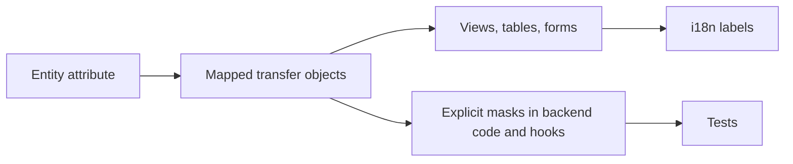

1. Add the attribute to the entity, then to every transfer object that maps it.
2. If backend code or a frontend hook queries with an explicit mask, add the attribute to that mask. Without a mask, every attribute is returned anyway.
3. Add i18n labels and update the tests that build or assert the entity.
4. To remove one, first delete it from views, tables, forms, derived members and bindings. Then remove it from the entity, or model validation fails at build.

### K51 Workflow conditions as derived predicates

**For:** showing and allowing actions based on status, without flags that drift.

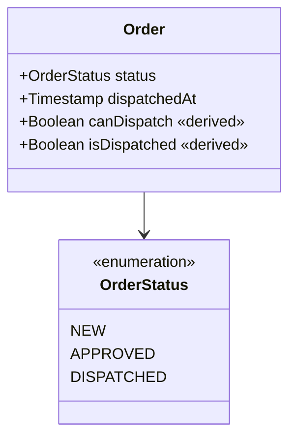

1. Keep the real state in one enumeration attribute, e.g. `status`.
2. Model each condition ("can be dispatched") as a derived boolean whose getter reads the status and timestamps. Do not store it.
3. For role conditions, compare with the actor, e.g. `User!filter(u | u.email == String!getVariable('ACTOR', 'email'))`.
4. Use the derived booleans to hide buttons in the UI, and check the same condition again in the operation (see K60).

### K52 Model changes that break custom frontend code

**For:** regenerating after a model change without broken custom hooks.

1. Before renaming or removing a member, operation or transfer object, search `src/custom` for its name.
2. Regenerate. The TypeScript surface follows the model, so old references fail with TS2339 or TS2307.
3. Turn on the hook flag in the model (e.g. `generateActionsHook`) for every page you customise; hook files are emitted only then.
4. Add new fields, columns and buttons as model UI elements, and customise them through hooks instead of writing replacement components.
5. For leftover generated frontend files, regenerate with `judo.sh -i`.

### K57 Business errors

**For:** errors the user can read and the frontend can translate, instead of a 500.

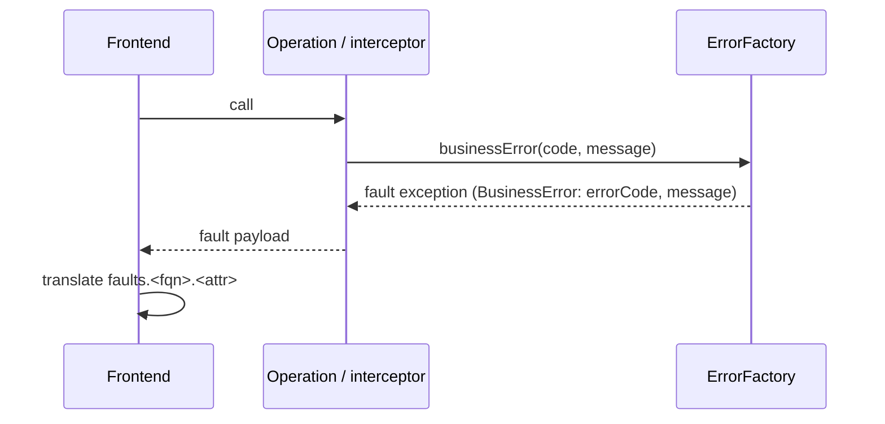

1. Model one unmapped transfer object for business errors with a string `errorCode` and a `message`. A string is easier to extend than an enum.
2. Declare it as a fault on every operation that can fail; each fault gets a generated exception class.
3. Create errors through one small factory. Use a validation error with the attribute name for field problems, and the business fault for rule, permission, state and external failures.
4. In interceptors, throw `InterceptorCallBusinessException` with the fault's type so the frontend dialog translates it. Never wrap faults in a `RuntimeException`.

### K58 Validation problems as returned data

**For:** showing every problem in a batch at once instead of failing on the first. This is an optional pattern for that one case; normally a failing operation throws a business error (K57).

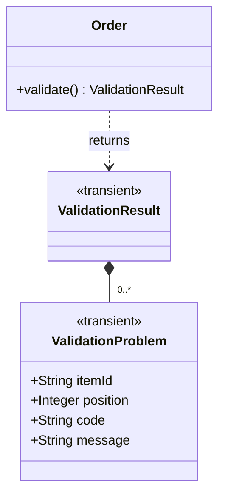

1. Give the operation an optional transient output transfer object listing the problems (item id, position, code, message).
2. No rows means success; real rule violations still throw (K57).
3. To keep the problems, store them as a composition child, and load the list only when the user opens it.

### K59 Operation input prefill and range selectors

**For:** "generate" operations that start from sensible defaults and offer only valid choices.

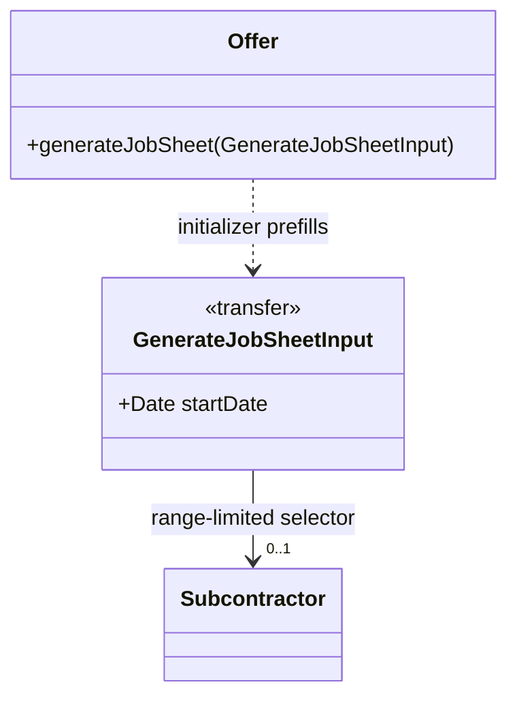

1. Give the operation its own `*Input` transfer object instead of reading the entity directly.
2. Prefill it with an initializer from the current instance.
3. Add range expressions to its relations so the selectors offer only valid targets.
4. Use the selected value as delivered; do not reuse the range object to set references elsewhere.

### K60 Server-side rule enforcement

**For:** making sure rules hold even when someone calls the REST API directly.

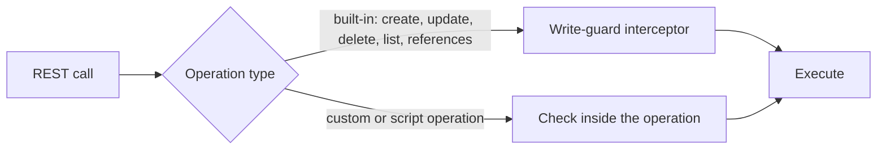

1. Hidden buttons and min/max hints are UI only. Generated endpoints stay callable, and the backend stores out-of-range values.
2. For built-in calls (create, update, delete, list, reference changes), enforce role and state rules in a write-guard interceptor that lists the operation FQNs per role.
3. Interceptors do not run for custom or script operations, so repeat the check inside each custom operation.

### K61 Field-level role-based edit guards

**For:** letting only some roles edit some fields of a shared entity.

1. Hide the field from the views of roles that may not edit it.
2. Add an update guard (interceptor, K60) that rejects changes to that field from other roles.

### K62 Actor role gates and visibility

**For:** controlling which menus and pages each role sees.

1. Put visibility flags (hidden menu items, access gates) on the principal or service-user transfer object, not on the plain entity.
2. A role gate on an access controls who can open it. It does not limit rows to the user's own data; use an access filter for that.

### K63 Serving stored files

**For:** downloading files without exposing storage ids.

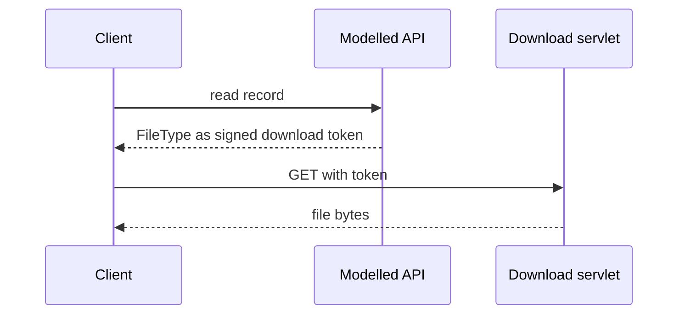

1. Model files as `FileType` attributes; clients receive a signed download token, not the filestore id.
2. Let clients fetch the bytes with that token from the platform download servlet.
3. Do not build your own URLs from filestore ids. If you serve files from custom code, check access first.

### K64 Native SQL from custom code

**For:** the rare query the DAO API and JQL cannot express.

1. Try the DAO-level API first, and suggest the missing concept to the platform team.
2. Only then use the JDBC `DataSource` in a custom service, read-only where possible.

### K65 Non-Java sidecar services

**For:** adding a Node or AI service next to the JUDO app.

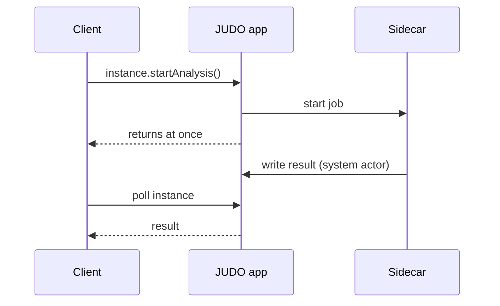

1. Publish the sidecar as its own image and wire it in compose with consistently named env variables.
2. For slow work, model an instance-bound custom operation with no input that starts the job and returns at once; the client polls the instance for the result.
3. If the sidecar calls the app, give it its own system actor and protect those endpoints.

### K66 E2E testing for JUDO apps

**For:** fast, repeatable browser tests.

1. Build one prepared database dump once, Keycloak users included (Keycloak shares the backend database).
2. Start each test group from that dump, with parallel stacks on separate ports.
3. Test through real pages. Keep only access checks (hidden menus, forbidden calls) as REST tests.
4. Keep a run around two minutes. Timestamps arrive in UTC and display in the browser's zone, so assert dates with that in mind.

### K67 Self-contained integration tests

**For:** fast tests that do not depend on shared master data.

1. Each test class creates only the entities it needs, through DAO builders or fixtures.
2. Use `@JudoTest(dataSourceMode = BY_CLASS, shareInjector = true)` so the runtime is built once per class.

### K69 Handlebars document templates

**For:** documents written as Markdown templates and rendered to DOCX and PDF. This replaces the deprecated XDocReport DOCX templates.

1. Write the template as `.md.hbs`.
2. Number nested lists with the loop variables `@index_1`, `@first` and `@last`; no custom helpers are needed.
3. Render to Markdown, then convert to DOCX and PDF. Escape text that goes into the frontmatter.

### K70 Registry number allocation

**For:** gap-free, unique document numbers.

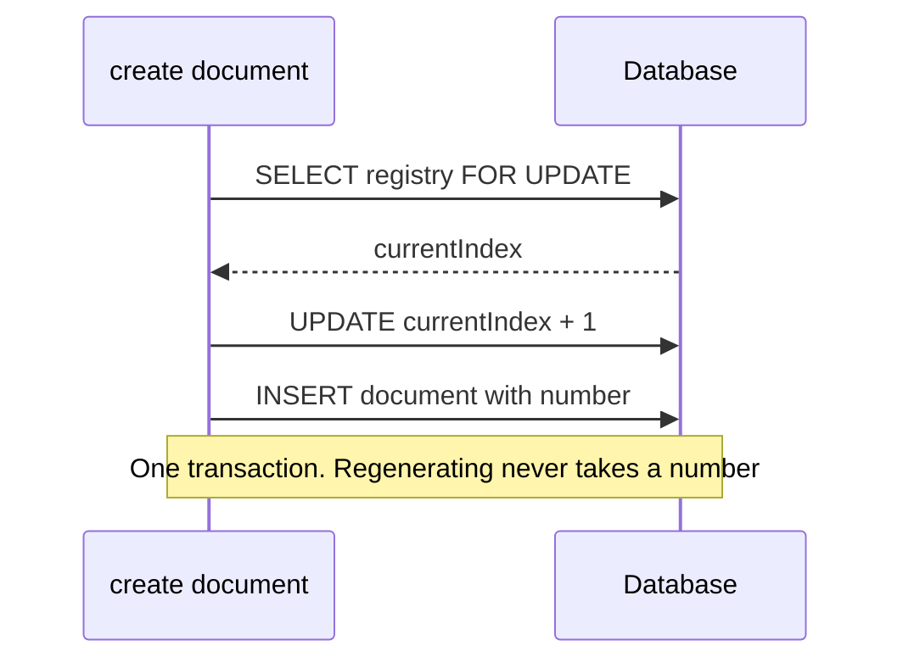

1. Keep a registry entity with `currentIndex`.
2. Take a number only when a document is created, never when it is regenerated.
3. Read and increment the index under a database lock in the same transaction; `synchronized` in Java is not enough.
4. Keep the document number separate from its version.

### K71 Readable history messages

**For:** an audit trail users can read in both languages.

1. Write each history entry from i18n keys in both languages.
2. Fill in dates and enum labels, not raw values or ordinals.

## Part 2: Model blueprints

Each blueprint has one line on what it is for, then a walkthrough of how to build it in an ESM model.

### K72 Ticket lifecycle with role and state gates

**For:** partners reporting faults and operators processing them to closure.

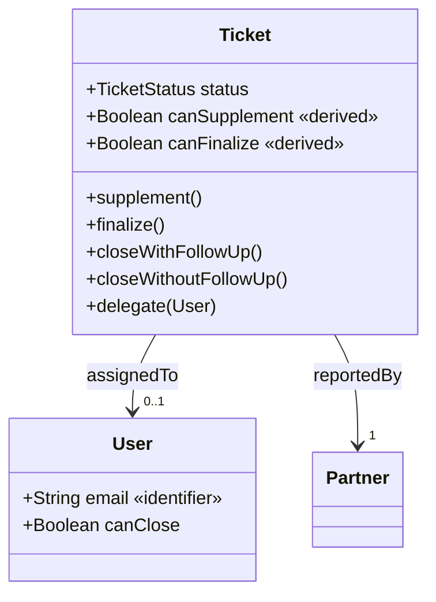

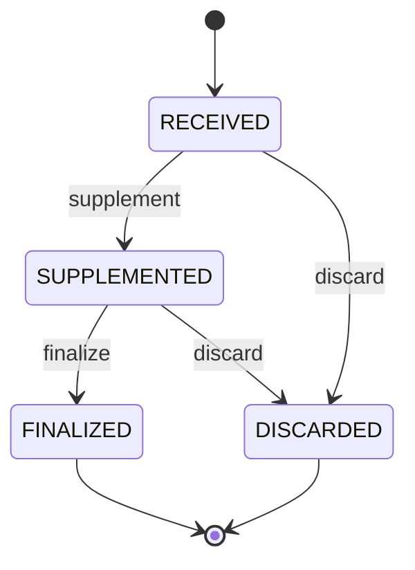

1. Model a `Ticket` entity with a `status` enumeration: RECEIVED → SUPPLEMENTED → FINALIZED, or DISCARDED.
2. Add derived booleans such as `canSupplement` and `canFinalize` that combine the status with the actor's role (K51).
3. Model one operation per transition, and add two operations that exclude each other: close with follow-up and close without.
4. Keep the right to close as a per-user flag on the user entity.
5. A `delegate` operation sets the assigned user. That user owns every document created from the ticket later, and other roles see it read-only.
6. Guard every transition inside the operation as well (K60).

### K73 Job sheet → work report → completion certificate

**For:** turning an accepted offer into field work and a signed-off result.

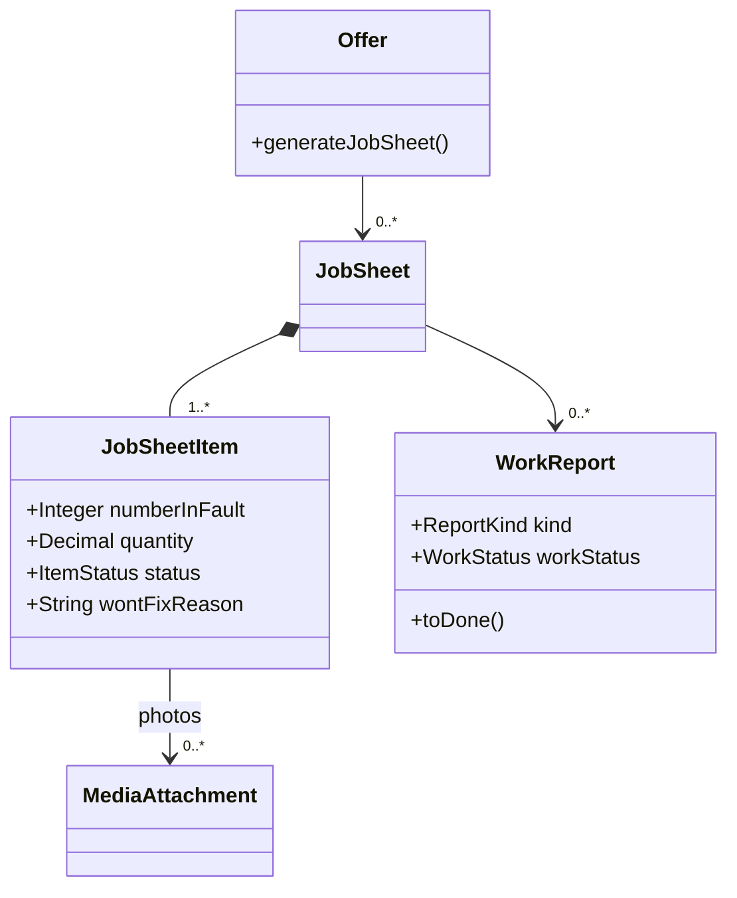

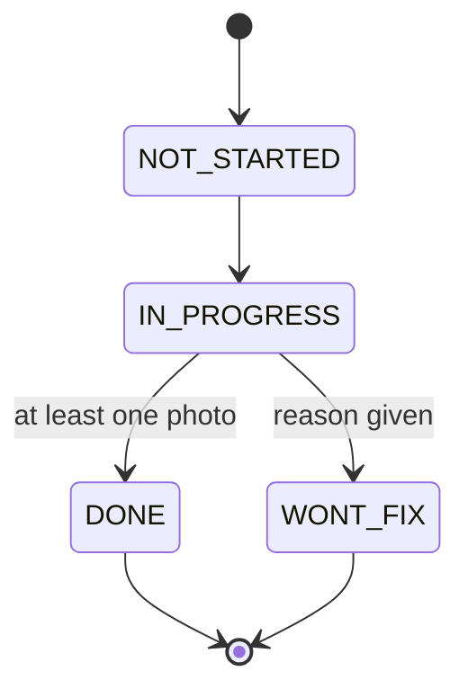

1. On the accepted `Offer`, a `generateJobSheet` operation creates `JobSheetItem`s split by fault and quantity, numbered per fault. Allow it only before the offer is done and while no completion certificate exists.
2. Each `WorkReport` has a `kind` (WORK_REPORT or COMPLETION_CERTIFICATE) and a `workStatus`.
3. A `toDone` operation checks the kind: a work report needs its documents generated first.
4. An item goes to DONE only with at least one photo, and to WONT_FIX only with a reason given in the operation input.
5. Generate the documents with K69 and number them with K70.

### K74 Offline-first mobile upload

**For:** technicians on a mobile phone sending reports with photos over a bad connection.

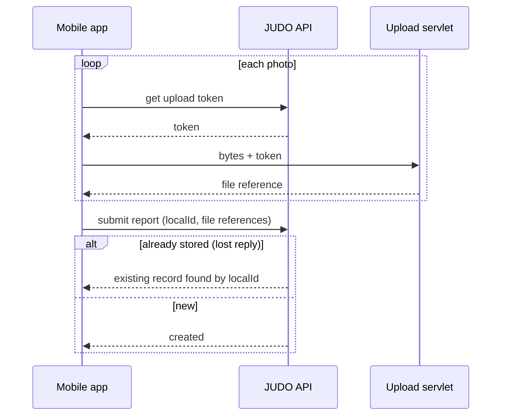

1. Give each record and each media file a client-made `localId`, stored and filterable (`filterByLocalId`).
2. Upload each file on its own: get an upload token, send the bytes to the upload servlet, keep the returned file reference.
3. Submit the record with all file references in one call. On a resend, look it up by `localId` first, so nothing is created twice.
4. Add change timestamps (e.g. `catalogueChangedAt`) on the root transfer object, so the app pulls only what changed.
5. Map the mobile app to its own Keycloak client and actor, and protect its endpoints.

### K75 Offer pricing with a minimum floor

**For:** offers with separate costs and prices, a markup, and a minimum total per currency.

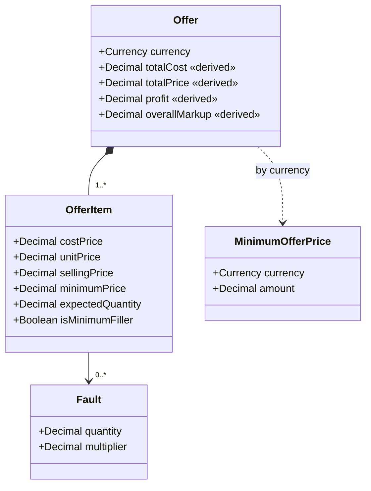

1. Each offer line keeps a cost side (cost price) apart from a price side (unit price, selling price, line minimum).
2. Derive the totals, profit and overall markup on the offer.
3. Keep a minimum offer price per currency. If the included services fall below it, add one dummy line for the gap; materials and other items come on top.
4. On every save, recalculate each line's `expectedQuantity` as the sum of `fault.quantity × multiplier` over its faults (multiplier 1 by default).

### K76 Partner-scoped multi-role users

**For:** an operator organisation and its partner companies sharing one app, each seeing only its own users and data.

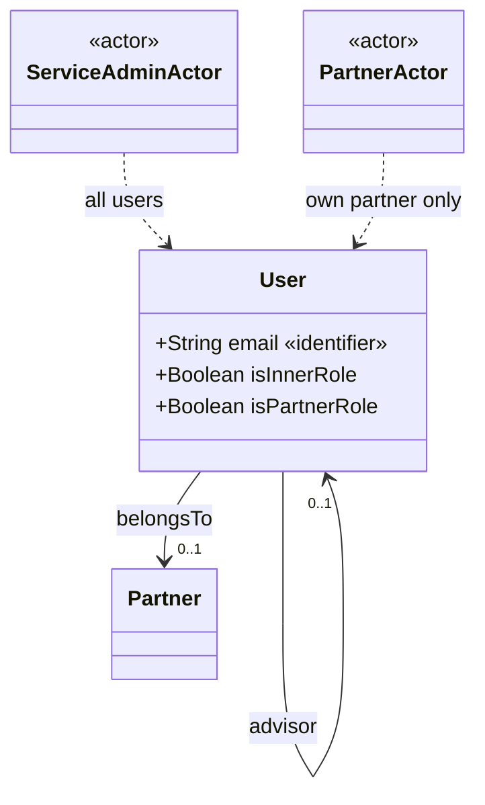

1. Split roles into two families: operator (inner) roles and partner roles. One user can't hold both; check this when the user is created.
2. Partner roles reach users and data only through an access filtered to their own partner. Only the service admin has a global users access.
3. Link each partner user to an advisor (a two-way relation). Partner users submit to their advisor; inner roles delegate among themselves.

### K77 Media attachments with several owner types

**For:** photos, videos and audio attached to many kinds of records.

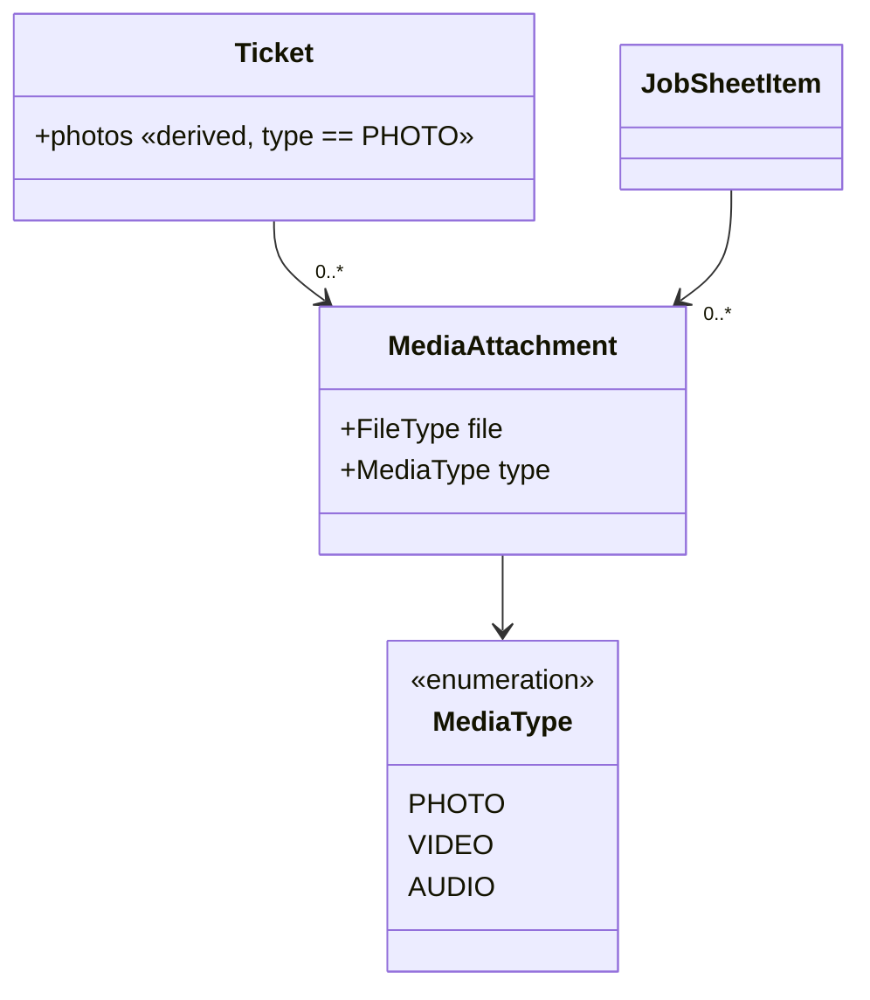

1. Model one `MediaAttachment` entity with a `FileType` file and a `MediaType` enumeration (PHOTO, VIDEO, AUDIO).
2. Link it from each owner type, with a back-reference so the owner can always be found.
3. Add derived filters such as "photos only" by `MediaType`.
4. Every client, the frontend and external systems alike, gets a download token through the modelled API and fetches the bytes from the download servlet; uploads go through the upload servlet (K74).

### K78 Delete versus discard with retention

**For:** deciding what happens when a user removes a record.

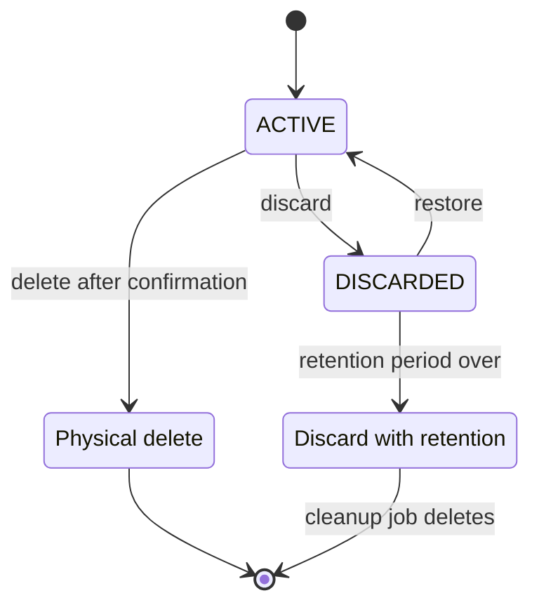

1. If nothing needs to be restored and personal data must really disappear (e.g. voice recordings), delete physically after a confirmation dialog.
2. If restore matters, add a DISCARDED state, a separate list with its own permission, and a scheduled job that deletes discarded records after the retention period.
