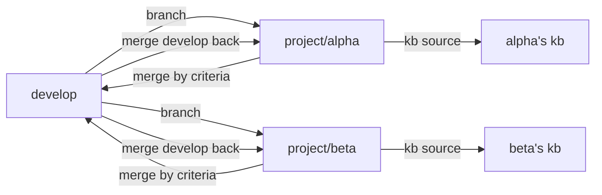

# Contribute from your project: your own catalog branch

The catalog grows from use. Each JUDO project works on its own branch of this repository, `project/<project-id>`. Your project's kb reads that branch, so your agents see your additions immediately. The maintainer merges what passes the [merge criteria](../../judo-catalog-maintain/references/merge-criteria.md) into `develop`, and new projects branch from `develop`. No separate consent step: pushing to your project branch is the contribution.



## 1. Create or reuse your branch

```bash
git clone git@github.com:BlackBeltTechnology/judo-blueprint.git   # once
cd judo-blueprint
git fetch origin
git checkout develop && git pull
git checkout -b project/<project-id>        # new project: branch from develop
# or, if it exists already:
git checkout project/<project-id> && git pull
git push -u origin project/<project-id>     # first time only
```

- `<project-id>` is the lowercase repository name of your JUDO project (for example `project/park-here`).
- A new project adds its row to `.pi/skills/judo-catalog-maintain/references/PROJECTS.md` in its branch (URL, kind, branch, weight 0). The maintainer sets the weight on merge.
- One branch per project, shared by the people working on it. Personal experiments go in short-lived `project/<project-id>-<topic>` branches that you merge into your project branch.

## 2. Point your project's kb at your branch

From the catalog clone:

```bash
skills/judo-blueprint/scripts/pin-source --branch project/<project-id> --project /path/to/your/app
```

This writes a git kb source for your branch with `subdir: catalog` into `/path/to/your/app/.pi/dashboard/knowledge_base.json`. Remote sources are not re-indexed automatically: after every push, re-index in your app (`kb index`, or `/reload` in pi). Production projects that only consume should pin a release tag instead (`pin-source v1.2.0`).

## 3. Add what is missing

When your agent (or you) hits something the catalog does not answer, add it in your branch:

| You found | Do this |
|---|---|
| A platform fact is missing or wrong | Edit `catalog/agent-docs/...`. Add evidence: a judo-ng `repo@sha:path:line`, or a reproducible check. Unproven: write *verify*. |
| A pattern your project uses that the catalog lacks | New entry with the `judo-blueprint-author` skill (frontmatter, Mermaid structure diagram drawn from your model). |
| An existing entry your project also uses | Add your project to `projects:`, a real path to `evidence:`, the `project:` tag; recompute `status`. This is how entries become `established`. |
| Your method differs from an entry | Do not overwrite the entry's method. Add it under `## Variations`, or as a new entry listed in `alternatives:` of both. Overwrite only when the existing text is wrong, with evidence. |
| An entry is wrong for your case | Fix the claim and add the evidence that shows why; keep the rest. |

Write generically: no project names or client business words in the body (`entry-lint` rejects project names). Your project appears only in `projects:`, `evidence:` and `project:` tags.

## 4. Check, commit, push, re-index

```bash
skills/judo-catalog-maintain/scripts/check-all              # must pass before you push
git add -A catalog .pi/skills/judo-catalog-maintain/references/PROJECTS.md
git commit -m "catalog(<project-id>): <what and why>"
git push
# then in your app: kb index   (or /reload in pi)
```

- One topic per commit, so the maintainer can merge it on its own.
- Only `catalog/` and your `PROJECTS.md` row. Skill or script changes go in a separate commit with a reason; they are reviewed separately.
- Never push to `develop`, `master` or tags.

## 5. Stay current

After the maintainer merges into `develop`, bring it into your branch:

```bash
git checkout project/<project-id> && git fetch origin && git merge origin/develop
skills/judo-catalog-maintain/scripts/check-all && git push
```

Resolve a conflict by keeping both methods (variation or alternative), not by deleting the other one.
